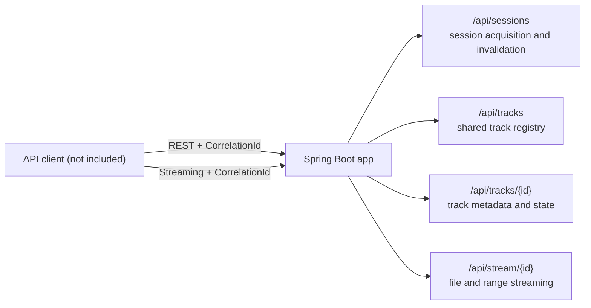
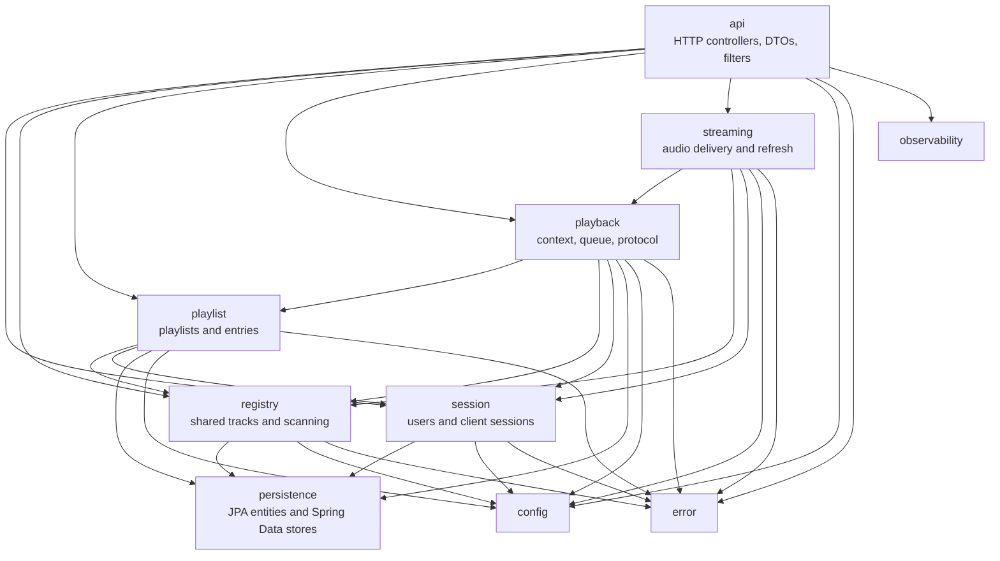

# Gravifon

Local-network audio player

## Architecture



The server is organized as vertical slices with one-way dependencies. Each
slice keeps its domain models, application behavior, and repository code
together; `api` and `persistence` are shared boundary packages.



`session` owns users and client sessions; `registry` owns shared file and
stream tracks; `playlist` owns playlists and entries; `playback` owns playback
context, queue, and protocol; `streaming` delivers audio and refreshes upcoming
stream URLs. `api` translates HTTP requests and responses, while `persistence`
encapsulates JPA entities and Spring Data stores.

Slices communicate through synchronous Spring events when another slice must
react atomically within the caller's transaction. Coordinators use
multi-bean `List<Port>` injection to aggregate contributions from zero or more
slices without depending on those slices directly; ordered strategy lists
select the first provider that supports a request.

This phase retains shared tracks and audio delivery. Track operations include
`GET /api/tracks`, `GET /api/tracks/{id}`, `PATCH /api/tracks/{id}/metadata`,
and `POST /api/tracks/{id}/state`. Playlist and playback routes, including
`POST /api/playback/init`, remain unavailable pending the coordinated playback
redesign. There is no browser client in this repository.

The current Flyway schema stores the track registry in embedded H2. Since the
initial schema changed, an existing development database must not be reused
against this revision. For disposable development data, stop the application
and point it at a new empty configuration directory to create a fresh database:

```bash
mkdir -p "$HOME/.config/gravifon-phase-1"
GRAVIFON_CONFIG_DIR="$HOME/.config/gravifon-phase-1" \
GRAVIFON_LIBRARY_DIR=/path/to/music \
mvn spring-boot:run -Dspring-boot.run.profiles=local
```

This preserves the previous database in its original directory. Do not replace
or delete a configured database unless its data is confirmed disposable.

## Client session lifecycle

Acquire one server-issued session ID per player instance:

```bash
curl -i -X POST http://localhost:8080/api/sessions \
  -H 'Content-Type: application/json' \
  -d '{"username":"Alice"}'
```

The response is `201 Created` and contains `sessionId`, `userId`, `username`,
`lastActivityAt`, and `expiresAt`, for example:

```json
{
  "sessionId": "server-issued-session-id",
  "userId": "stable-user-id",
  "username": "Alice",
  "lastActivityAt": "2026-01-01T12:00:00Z",
  "expiresAt": "2026-01-02T12:00:00Z"
}
```

Except for session acquisition, every `/api/**` request requires the returned
ID in `X-Client-Session`. This includes current-session invalidation:

```bash
SESSION_ID='server-issued-session-id'
curl -i http://localhost:8080/api/tracks \
  -H "X-Client-Session: $SESSION_ID"

curl -i -X DELETE http://localhost:8080/api/sessions/current \
  -H "X-Client-Session: $SESSION_ID"
```

For `GET /api/stream/{trackId}`, clients may present the ID as the `session`
query parameter instead, including with byte-range requests. If both the header
and query parameter are supplied, they must match. The query parameter is not
accepted on other API routes. A missing, unknown, expired, or invalidated
session returns `401 SESSION_REQUIRED`; malformed or conflicting presentation
returns `400 INVALID_INPUT`. No session cookie is created.

Several sessions may resolve to the same stable user, and acquiring or
reacquiring a session does not invalidate other sessions or trigger playback.

Usernames are trimmed and matched case-insensitively, but are unverified
selectors rather than credentials: anyone who can call the API can claim a
username and select that user's state. They are not identity verification or
access control. Session records and their activity timestamps persist across
server restarts. Valid request initiations renew inactivity; the default
inactivity timeout is 24 hours (`GRAVIFON_SESSION_INACTIVITY_TIMEOUT`). An
expired or explicitly invalidated session cannot renew itself, so its caller
must acquire a new session. Hourly cleanup is configured by
`GRAVIFON_SESSION_CLEANUP_CRON`; set it to `-` to disable cleanup. Cleanup
removes only eligible session records, not users or their durable state.

There is no heartbeat. Expiration does not interrupt an already-open audio
response, and bytes delivered by that response do not renew activity; each new
audio or range request is validated at its initiation. No browser client or
client-side session storage is included; API callers must retain the session ID
for their own player instance and reacquire it after expiration.

## Shared stream registration

An authenticated caller can register a source that a configured resolver
supports. The API returns track IDs in resolver order and retains repeated
references:

```bash
curl -i -X POST http://localhost:8080/api/tracks/streams \
  -H 'Content-Type: application/json' \
  -H "X-Client-Session: $SESSION_ID" \
  -d '{"sourceUrls":["https://provider.example/album"]}'
```

The response is `200 OK` with a `trackIds` array. Each source must be nonblank;
URL syntax and supported schemes (including whether plain HTTP is allowed) are
decided by the matching resolver. Unsupported sources return `400 INVALID_INPUT`;
resolver failures return `500 SERVER_ERROR`. This phase does not include a
production resolver, so the example requires an application integration that
supplies one. Registering sources only creates or reuses shared tracks; it does
not create playlists or start playback.

## Build and verify

```bash
mvn spotless:apply   # required when modifying Java sources
mvn clean verify
```

Line coverage ≥ 80% on business logic is enforced by JaCoCo during `verify`.

## Development container

The recommended development environment is the Dev Container in `.devcontainer/`.
It provides Java 21, Maven, Node 22, OpenSpec, Docker CLI, Docker Compose, and
an isolated Docker-in-Docker daemon. Rebuild or recreate the Dev Container after
changing its features.

Run the complete verification workflow from inside the Dev Container:

```bash
mvn clean test
mvn clean verify
docker compose config
docker compose down -v
docker compose up --build
```

The nested daemon has its own containers, images, networks, and volumes; it does
not use the host Docker socket or share host Docker state. This development
environment behavior is separate from the application container runtime
described below.

## Run locally

```bash
GRAVIFON_LIBRARY_DIR=/path/to/music mvn spring-boot:run -Dspring-boot.run.profiles=local
```

Open `http://localhost:8080`.

## Run in a container

```bash
mvn clean verify -Pdocker
docker compose up
```

The Docker profile builds the image locally; Compose consumes it. Runtime configuration (mounts, ports, environment) is defined in the containerized-runtime spec.

The container uses `/music` for the read-only library and `/config` for the embedded
database (`gravifon.mv.db`). Compose uses Docker-managed volumes by default, so no
host directory is assumed or tracked. Set `GRAVIFON_LIBRARY_PATH` to a host music
directory (for example, `~/Library`) and `GRAVIFON_CONFIG_PATH` to a host config
directory when persistence outside Docker is required. Both variables also accept
named volumes. The application paths are `/music` and `/config`, configurable with
`GRAVIFON_LIBRARY_DIR` and `GRAVIFON_CONFIG_DIR` when running outside Compose.
Proactive upcoming-track refresh is temporarily absent until the playback
redesign restores its queue-aware scheduler. The related refresh-count and cron
settings remain reserved but inactive. Request-time stream URL refresh remains
enabled.

## Health and probes

The application exposes these Actuator endpoints:

- `GET /actuator/health` reports aggregate health, including the database, music-library mount, and the latest library-scan outcome. A scan failure is reported as detail and does not by itself mark the service unhealthy.
- `GET /actuator/health/readiness` reports whether the database and readable music-library mount are available. It does not wait for or depend on a library scan.
- `GET /actuator/health/liveness` reports application-process health only; recoverable database, mount, or scan failures do not make the process unlive.

Compose polls `/actuator/health` for container health. This is an observability signal and does not itself restart the container.

For a host-backed persistence check:

```bash
GRAVIFON_LIBRARY_PATH="$HOME/Library" \
GRAVIFON_CONFIG_PATH="$(mktemp -d)" \
docker compose up --build
```

## Conventions

- **Testing:** JUnit 5 + AssertJ + Mockito + Spring Boot test slices; use `@MockitoBean`
- **Clean verification before merge:** `mvn clean test` and `mvn clean verify`; for container-sensitive checks, `docker compose down -v` then `docker compose up --build`

### Logging severity

| Level | Intent |
|-------|--------|
| `trace` | High-detail troubleshooting; hot-path or repeated diagnostic events |
| `debug` | Diagnostic information useful during development or investigation |
| `info`  | Key lifecycle events (startup complete, track started, playlist selected) |
| `warn`  | Recoverable / unexpected conditions (missing CorrelationId, stalled audio, metadata unavailable) |
| `error` | Actual failures (scan error, audio decode failure, unrecoverable state) |

All server logs include `correlationId` in MDC. Client (SPA) logs follow the same severity table.

## Documentation

This repository is OpenSpec-first: `openspec/specs/` describes the status quo, `openspec/changes/` describes its evolution.
