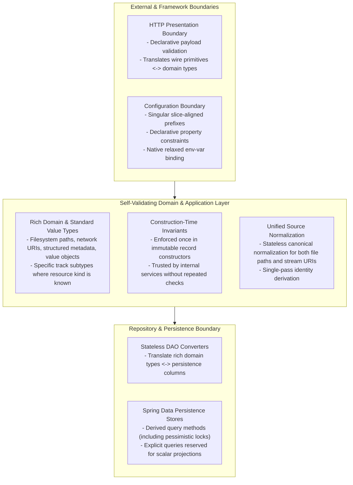

# Design

## High-Level Design Overview

This change establishes five cross-cutting architectural conventions across all vertical slices so that domain logic operates on rich, self-validating types while string/map serialization, declarative input validation, query derivation, and environment-variable binding remain strictly at outer framework boundaries:

## Context

While vertical slice isolation and framework-free domain packages are already enforced by architecture tests, several boundary and modeling inconsistencies exist across slices:

1. **Primitive obsession in domain models and internal contracts:** Filesystem paths, network URLs, structured track metadata, and user names are passed through domain records and internal services as raw strings or maps, and polymorphic operations accept base track types even when only a specific subtype is valid.
2. **Fragmented source normalization and repeated identity hashing:** Path separator normalization and URL canonicalization are split across callers and a single-implementation normalizer interface, causing repeated conversions and redundant identity hashing during library scan reconciliation.
3. **Redundant multi-layer defensive validation:** Internal services, persistence helpers, schedulers, and repositories repeat null, blank, negative-duration, and collection-element checks already enforced by external boundary validation or domain record construction.
4. **Unnecessary string queries in persistence stores:** Simple entity lookups, pessimistic row locks, and timestamp comparisons are written as custom query strings even where Spring Data derives the exact query from the method name.
5. **Misaligned configuration prefixes and placeholder boilerplate:** Configuration files wrap property defaults in explicit environment-variable placeholder expressions only because property prefixes drifted from singular slice names.

## Goals / Non-Goals

**Goals:**
- Represent domain concepts with rich standard or domain value types throughout domain models and application services, converting to and from raw strings or maps only at HTTP presentation and DAO converter boundaries.
- Consolidate filesystem path and stream URI normalization into a single stateless helper in the identity package and compute file track identity once per scanned file.
- Enforce validation at two boundaries only—declarative validation on external HTTP/configuration inputs and invariant checks in domain/command record constructors—eliminating duplicate defensive checks in internal services and repositories.
- Use Spring Data derived query methods (including pessimistic locking queries) for entity selection, reserving explicit query annotations for scalar projections.
- Align configuration prefixes with singular slice names so native relaxed binding resolves environment variables without placeholder aliases in configuration files.

**Non-Goals:**
- Changing external HTTP payload contracts, status codes, or database schema columns.
- Introducing dynamic specification executors or JPA metamodel code generation before dynamic multi-criteria filtering is needed.
- Introducing custom AOP validation aspects.

## Decisions

### 1. Rich Domain Types with Conversion Restricted to Presentation and DAO Boundaries

Domain models and internal service contracts use the most specific standard Java or domain value type for each concept:
- **Filesystem paths vs. network URIs:** Relative library paths use standard filesystem path types (`java.nio.file.Path`), whereas network source and stream addresses use `java.net.URI`.
- **Structured value objects:** Track metadata and user names remain encapsulated in their domain value objects across domain models and service signatures rather than being unpacked into raw maps or strings after validation.
- **Subtype specificity:** Internal operations that apply only to file tracks or only to stream tracks accept the specific subtype rather than the base type, resolving the subtype once at the entry boundary and eliminating downstream type checks and duplicate lookups.
- **Boundary-only serialization:** Conversion between these rich types and raw strings or maps happens exclusively in HTTP presentation DTO mapping and package-private persistence converters.

*Alternatives considered:*
- *Using `URI` for both relative filesystem paths and network URLs:* Rejected because standard filesystem APIs require a scheme to convert a `URI` to a `Path`, and `URI` percent-encodes spaces and characters (`#`, `[`, `]`) common in audio filenames, which would force awkward encoding/decoding round-trips for local file operations.

### 2. Unified Stateless Source Normalization and Single-Pass Identity Derivation

A single stateless utility in the framework-free identity package owns canonical normalization for both resource kinds:
- Relative filesystem paths are normalized, verified not to escape the root, and converted to a canonical forward-slash string only when deriving deterministic track IDs or persisting to a text column.
- Network URIs have their scheme and host lowercased, path normalized, volatile tracking query parameters stripped, and remaining query parameters canonically sorted.
- Scan reconciliation computes the deterministic file track ID once per scanned file and carries it on the resulting reconciliation decision so downstream coordination never re-hashes the path.
- Single-implementation normalizer interfaces are removed under YAGNI.

*Alternatives considered:*
- *Using framework URI builder utilities inside the identity package:* Rejected because identity and domain model packages must remain pure Java and free of framework dependencies.

### 3. Two-Boundary Validation Without Redundant Internal Re-Checks

Validation is enforced at two boundaries:
1. **External HTTP and Configuration Boundary:** Declarative Bean Validation on HTTP request DTOs and configuration property records.
2. **Type Construction Boundary:** Plain-Java invariant checks inside domain and command record compact constructors.

Once an input has been decoded into a validated configuration record or constructed as a domain/command record, internal application services, package-private persistence helpers, schedulers, and repositories trust its invariants and do not repeat null, blank, or duration checks.

*Alternatives considered:*
- *Custom AOP validation aspects on internal services:* Rejected because Spring already provides declarative validation at HTTP and configuration boundaries, while record compact constructors guarantee invariants everywhere—including isolated unit tests without framework proxies.

### 4. Spring Data Derived Queries Over Custom Query Strings

Persistence store interfaces use Spring Data derived query methods for entity lookups, timestamp/nullability predicates, and pessimistic write locks. Explicit query strings are reserved strictly for cases that derived queries cannot express cleanly, such as single-column scalar projections across associations.

*Alternatives considered:*
- *JPA `Specification` executors with static metamodel generation:* Deferred under YAGNI because all current and planned queries are fixed static predicates validated by Spring Data at startup, and specification executors do not support scalar column projections.

### 5. Singular Slice-Aligned Configuration Prefixes with Native Relaxed Binding

Configuration property prefixes use singular slice names and property keys that match the external environment variable names under Spring Boot's relaxed binding rules. Configuration files declare literal default values directly without redundant `${ENV_VAR:default}` placeholder expressions.

*Alternatives considered:*
- *Retaining explicit `${ENV_VAR:default}` placeholders in `application.yml`:* Rejected because duplicating environment variable names in YAML obscures native relaxed binding and encourages naming drift between configuration records and deployment environment variables.

## Risks / Trade-offs

- **[Syntactically invalid source URLs fail at boundary decoding]** -> Parsing source URL strings into `URI` at the controller boundary rejects malformed URI syntax immediately as `400 INVALID_INPUT`, while syntactically valid URIs with unsupported schemes continue to reach resolver lookup as before.
- **[Configuration prefix alignment spans code, YAML, and test overrides]** -> Updating property prefixes, scheduler expressions, YAML defaults, and test property overrides together in one change ensures full suite verification catches any stale property key immediately.

## Verification Strategy

- Run unit, controller slice, JPA slice, architecture, and full integration test suites (`mvn clean test` and `mvn clean verify`) to confirm behavior, architecture rules, and ≥ 80% business-logic coverage.
- Verify container configuration and relaxed environment binding via `docker compose config`, `docker compose down -v`, and `docker compose up --build`.
