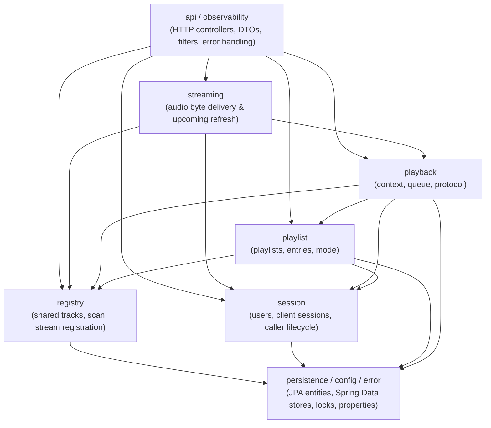

# Design

## High-Level Design Overview

Gravifon is a single-artifact Spring Boot application organized into vertical functional slices (`session`, `registry`, `playlist`, `playback`, `streaming`) flanked by shared boundary packages (`api`, `observability`, `persistence`, `config`, `error`). Each vertical slice owns its domain models (`model`, `identity`), application orchestration (`service`, `scan`, `stream`, `metadata`), and domain-typed persistence access (`repository`).

## Architectural Decisions

### 1. Enforced Vertical Package Slices and Horizontal Purity via Plain ArchUnit

**Decision:** Enforce both vertical slice dependencies and horizontal layer purity directly from package naming conventions using plain ArchUnit rules, removing all jMolecules dependencies and annotations.

| Slice / Package | Allowed slice dependencies | Forbidden dependencies |
|---|---|---|
| `session` | `persistence`, `config`, `error` | `registry`, `playlist`, `playback`, `streaming`, `api`, `observability` |
| `registry` | `persistence`, `config`, `error` | `session`, `playlist`, `playback`, `streaming`, `api`, `observability` |
| `playlist` | `session.model`, `session.repository`, `registry.model`, `registry.repository`, `persistence`, `config`, `error` | `playback`, `streaming`, `api`, `observability`, `session.service`, `registry.service/scan/metadata/stream` |
| `playback` | `playlist.model`, `session.model`, `session.repository`, `session.service`, `registry.model`, `registry.repository`, `persistence`, `config`, `error` | `playlist.service`, `playlist.repository`, `streaming`, `api`, `observability` |
| `streaming` | `registry`, `playback`, `session.model`, `config`, `error` | `playlist`, `persistence`, `api`, `observability` |
| `persistence` | None | All vertical slices, `api`, `config`, `observability` |
| `api` | All vertical slices, `config`, `error`, `observability` | `persistence` |

Horizontal purity rules apply uniformly within every slice:
- `..model..` and `..identity..` (excluding `api.model`) remain pure Java, free of Spring, Jakarta, Lombok, media libraries, and outer packages.
- `..service..`, `..scan..`, and `..stream..` never depend on `..api..` or `..persistence..`.
- Public method signatures in `..repository..` expose only domain types, never `persistence` entities or Spring Data types.

**Rationale:** Package-based ArchUnit rules automatically cover every class created in the repository without requiring developers or agents to remember `@DomainRing` or `package-info.java` annotations, and they enforce vertical slice isolation that onion-ring annotations cannot express.

**Considered Alternatives:**
- *Keep jMolecules (`jmolecules-ddd`, `jmolecules-onion-architecture`, `jmolecules-archunit`)*: Rejected because unannotated classes silently bypass checks, mixed packages require per-class ring overrides, Java records clash with `AggregateRoot` ceremony, and horizontal rings do not prevent cross-slice coupling.
- *Multi-module Maven build (`pom.xml` per slice)*: Rejected for now because all slices share a single Flyway migration (`V1__init.sql`), ordered pessimistic locks (`USER -> TRACK`), and unified `@DataJpaTest` / JaCoCo / Docker build pipelines. Enforced vertical packages provide the same compile- and test-time boundary guarantees without multi-JAR build overhead, while keeping a future Maven module split trivial if ever needed.

### 2. YAGNI Simplification and Isolated Repository Converters

**Decision:**
1. **Lean domain models**: Use canonical domain types directly (e.g., validated `String id` and normalized `Map<String, List<String>> metadata` on `Track`) rather than artificial value-object wrappers (`TrackId`) or duplicate accessors created only to satisfy `AggregateRoot`.
2. **Concrete single-implementation repositories**: Define each slice repository as a single concrete `@Repository` class in `<slice>/repository` rather than a 1:1 `*Repository` interface + `Jpa*Repository` adapter. Retain interfaces only where multiple implementations or boundary plug-ins exist (`StreamResolver`, `ReferencedTrackIdsPort`, `LibraryScanner`, `MetadataExtractor`, `TagWriteBackHandler`, `StreamProxy`, `MusicLibraryProbe`).
3. **Package-private, stateless domain-entity converters (`<slice>/repository/*Converter`)**: Encapsulate domain $\leftrightarrow$ JPA `*Entity` mapping inside package-private, stateless plain Java converter classes in `<slice>/repository` (not Spring `@Component` beans). Repositories invoke their package-private converter directly, keeping `@Repository` classes focused on persistence orchestration while testing conversion logic in isolated unit tests in the same package.

**Rationale:** Eliminates pass-through interface duplication while keeping JPA mutability (`persistence/*Entity` and `Jpa*Store`) strictly hidden behind `..repository..`. Because converters are stateless pure transformations, keeping them as plain package-private classes (rather than Spring beans) avoids unnecessary DI wiring, keeps `persistence` types invisible outside `<slice>/repository`, and lets `@DataJpaTest` slices import only the public `@Repository` class without test-only wrapper configurations.

**Considered Alternatives:**
- *Keep `*Repository` interfaces + `Jpa*Repository` adapters*: Rejected under YAGNI; service unit tests mock concrete repositories directly with Mockito, and `@DataJpaTest` imports the concrete repository and converter.
- *Keep mapping methods private inside `@Repository` classes*: Rejected because complex polymorphic and collection mapping bloats repository classes and can only be tested indirectly through slower `@DataJpaTest` slices.
- *Collapse JPA `*Entity` classes into domain records*: Rejected because JPA requires mutable, no-arg entity state and managed association lifecycles that conflict with immutable Java 21 domain records.

### 3. Hybrid Cross-Slice Communication Model

**Decision:** Match the cross-slice communication mechanism to the interaction semantics using standard Spring capabilities:

| Interaction shape | Mechanism | Rationale |
|---|---|---|
| **Atomic in-transaction state reaction** (upstream slice mutates state; downstream slice must react in the same transaction and lock scope without upstream knowing downstream) | Synchronous `@EventListener` via `ApplicationEventPublisher` | Runs on the caller thread inside the active `@Transactional` boundary so any failure rolls back both slices atomically while keeping one-way slice dependencies intact. |
| **Best-effort post-commit broadcast** (non-blocking side effects after commit) | `@TransactionalEventListener(phase = AFTER_COMMIT)` | Prevents slow or best-effort side effects from holding database locks or rolling back committed state. |
| **Pull aggregation across slices** (coordinator collects and merges data from 0..N slices) | `List<Port>` multi-bean injection | Allows `LibraryScanCoordinator` to union `ReferencedTrackIdsPort` results from any slice that registers a provider bean, defaulting cleanly to an empty list when none exist. |
| **First-wins strategy selection** (single provider handles a request and returns a result) | Ordered `List<Strategy>` injection | Explicit deterministic routing (e.g., `StreamResolverRegistry` over `List<StreamResolver>`) with explicit failure when no provider matches. |

**Considered Alternatives:**
- *Direct cross-slice service calls in both directions*: Rejected because it creates circular slice dependencies (e.g., `playlist <-> playback` or `session <-> playback`).
- *Spring events for pull queries or first-wins resolution*: Rejected because mutating a shared collector inside an event object is unidiomatic and obscures control flow compared to `List<Port>` injection.

### 4. Audience-Split Architecture Documentation

**Decision:** Separate architectural documentation by reader intent:
- **`README.md` (Human and machine orientation)**: Uses Mermaid `flowchart` diagrams and concise prose to explain system structure, slice responsibilities, and interaction flows at a glance.
- **`AGENTS.md` (Developer and agent execution)**: States authoritative package boundaries, YAGNI repository/converter rules, cross-slice event/provider rules, and verification commands aligned 1:1 with `DomainArchitectureArchUnitTest`.

**Rationale:** Humans browsing the repository need a clear mental model without wading through coding rules, while coding agents and implementors need unambiguous, enforceable constraints.

## Verification Strategy

- Verify vertical slice isolation, domain model purity, service isolation, and repository public signature rules via `DomainArchitectureArchUnitTest`.
- Verify domain-entity converters via isolated unit tests and repository wiring via `@DataJpaTest`.
- Run the full verification suite (`mvn spotless:apply`, `mvn clean test`, `mvn clean verify`) to confirm zero regressions and ≥80% JaCoCo line coverage.
