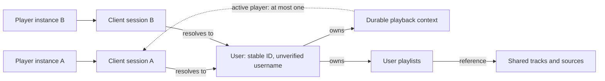

# Design

## Context

See [proposal.md](./proposal.md) for motivation and scope.

The session HLD and concrete contracts are complete for planning review. Part 2 and the delta specs define Phase 1; tasks describe implementation, not completed work. Implement this change before the related playlist/playback change.

The API currently has no caller-session identity. The related [playback design](../redesign-playlist-and-playback-queue/design.md) needs to distinguish player instances while keeping durable playback state independent of any one client's lifetime. There are no deployed databases, existing clients, or real data requiring compatibility.

## Part 1: High-Level Design

### Goals / Non-Goals

**Goals:**

- Give caller identity, durable state ownership, and playback authority separate responsibilities.
- Identify each player instance consistently on every API request.
- Preserve session identity across server restarts without coupling session acquisition to playback.
- Establish a user-resolution boundary that can accommodate future authentication without embedding it in the queue domain.
- Resolve client-supplied usernames to stable users without an artificial default-user case.

**Non-Goals:**

- Add a second player-instance identifier alongside `ClientSessionId`.
- Elect a browser-wide player or coordinate tabs through shared write sequencing.
- Choose client-side storage, token presentation, framework integration, or database mappings in the HLD.
- Implement authentication, authenticated authorization, or playback-write ordering in this change. User-scoped playlists and playback contexts are implemented by the related playback change.

### Decisions

#### 1. A client session identifies one player instance

The server issues an opaque `ClientSessionId` for a client instance, such as a browser tab or app instance. Distinct instances use distinct sessions even if they run in the same browser or belong to the same user.

`ClientSessionId` is the caller identity during communication with the server. No separate player-session or player-instance ID is required. How the client stores the identifier is not a domain concern.

Alternative considered: one browser-wide session used as the player identity. This would require cross-tab player election and sequence coordination. It does not match the selected per-instance model.

#### 2. Users own durable state; sessions identify callers

Session acquisition accepts a client-supplied username. Trim surrounding whitespace, reject blank names, and perform case-insensitive lookup. Resolve the existing user or create one when the normalized name is new. There is no implicit default user.

Each user has a stable server-issued ID. Sessions and durable state refer to that ID, not username spelling. Preserve display spelling separately from lookup identity; exact normalization, supported characters, and length limits belong in the concrete design.

A user may have multiple concurrent client sessions. That user's sessions share their playlists and playback context. Different users have separate playlists, queues, bookmarks, and active-player roles. Tracks and music sources remain shared. The playback change owns these state-scoping rules and the per-context active-player pointer.



Resolution and ownership are distinct from the active-player reference. Session existence alone does not grant the active-player role.

Alternative considered: let client sessions own playback contexts. Rejected for the selected user-owned model, where switching the player continues the same queue and bookmark.

Alternative considered: resolve every session to an implicit default user. Rejected because explicit username selection gives state ownership a uniform contract without a special default identity.

User selection is not authenticated login. Anyone supplying another username can acquire a session for that user and access their state. Partitioning by user does not provide authenticated protection. Future authentication can change how session acquisition resolves a user while retaining stable ownership references, but claiming existing unverified identities requires an explicit policy.

#### 3. Acquisition and validation are independent of playback

Session acquisition takes a username but no credentials in this change. It resolves or creates a user and creates caller identity, but does not take over playback, normalize intent, consume occurrences, rebuild the queue, or implicitly create playlists.

API requests require a valid client session, including audio streaming and range requests. Missing, unknown, expired, or explicitly invalidated identity produces an explicit session-required outcome. The client can acquire a new session, but this does not itself grant playback authority or imply replay of an uncertain command.

Alternative considered: combine acquisition with playback initialization or takeover. Rejected because obtaining caller identity and deliberately choosing where to play are different operations.

#### 4. Presentation must preserve per-instance identity

Every request must present the correct calling instance's `ClientSessionId`. This includes requests initiated through browser media facilities, not just API calls made by application JavaScript.

Client storage and request presentation remain concrete-design decisions. A normal same-origin cookie is shared across tabs and therefore cannot, by itself, distinguish their client sessions. A transport choice must satisfy the identity requirement rather than redefine its scope.

Alternative considered: mandate an HttpOnly cookie now for convenient media requests. Deferred because convenience alone does not satisfy distinct per-instance identity.

#### 5. Sessions survive server restart

Users, client sessions, and their association are persisted. Restart does not require a replacement identity merely because server memory was lost.

The playback change separately persists its active-player pointer, instruction reference, and applied-request deduplication state. Session infrastructure does not choose playback transitions or own queue state.

Persistence across restart does not reset the inactivity period or revive an expired or explicitly invalidated session.

Alternative considered: runtime-only sessions. Rejected because restart would unnecessarily invalidate callers and disrupt playback synchronization.

#### 6. Inactivity expiration and cleanup

Sessions expire after a configurable period of inactivity. Ordinary API requests presenting a valid session renew its activity, including audio and range requests. There is no dedicated heartbeat or fixed maximum lifetime from acquisition. Expired or explicitly invalidated sessions cannot be renewed by presenting their old ID.

Validation occurs for each new request. An already-open audio response does not require periodic session revalidation and is not terminated solely because its session later expires. Delivering more bytes on that response is not a session heartbeat.

Expired and explicitly invalidated session records may be cleaned up. Cleanup does not delete the associated user, playlists, or playback state. Session validity must not depend on when physical cleanup runs. Timeout values, renewal persistence, and cleanup scheduling belong in Part 2.

Alternative considered: fixed lifetime from acquisition. Rejected because active clients would need replacement sessions solely due to elapsed age.

Alternative considered: no automatic expiration. Rejected because abandoned player instances would retain sessions indefinitely.

#### 7. Client recovery and acquisition

There is no separate protocol rule for reload versus restart. A client without a session ID acquires a session. A client retaining its own session ID attempts normal communication; session validation and the playback request-sequence checks determine applicability.

Clients retaining a session normally retain its request sequence too. If the session is invalid, or the client cannot reconcile its sequence state, it acquires a fresh session. A stale sequence is not itself session invalidation and does not require another recovery identifier or negotiation protocol. Sequence ordering checks writes; it does not prove that client history survived a restart.

If a session-acquisition response is lost, the client may acquire again with the username. This creates a new session for the same resolved user; the unreachable session expires through inactivity. Acquisition needs no idempotency key, result cache, or guaranteed delivery. Existing sessions are not invalidated by another acquisition, and acquisition never takes over playback.

This follows best-effort synchronization: acquiring a new identity does not silently replay uncertain playback commands. Client-side storage remains a concrete choice and must preserve the per-instance identity boundary.

Alternative considered: mandatory new sessions on every client reload or restart. Rejected because recovery depends on available session and sequence state, not a particular client lifecycle event.

Alternative considered: deduplicated acquisition with client-generated request identities. Rejected because an abandoned session has no playback side effects and is bounded by inactivity expiration.

#### 8. Session invalidation removes authority, not playback state

When an expired or explicitly invalidated session was the active player, its owning playback context has no active player. Its authority must become ineffective as soon as the session is invalid, even if physical session cleanup happens later. A stale stored pointer cannot authorize playback writes.

Preserve queue, current occurrence, source continuation, bookmark, transport intent, and last execution observation. Session invalidation is not a Pause, Stop, completion, or playback failure. It does not prove that local audio stopped and does not terminate an already-open audio response.

Another valid session of the same user may explicitly take over under the playback protocol. A session of another user cannot take over this context. Reacquiring a session does not automatically restore the old player role.

The session infrastructure determines validity; the playback application boundary clears the stored active-player reference if it still points to that session, without changing playback facts. Physical deletion can follow later. Request-time expiration detection must enforce authority loss without waiting for scheduled cleanup; delayed cleanup must not clear a newer player. Do not introduce separate stored/effective active-player models. The transaction and cleanup strategy belongs in Part 2.

Alternative considered: normalize Play intent to Pause on expiration. Rejected because inactivity is not a transport command or evidence that audio has stopped.

### Risks / Trade-offs

- [Shared storage collapses distinct player instances into one identity] -> Require per-instance identity on all requests and validate the selected transport against multiple-tab behavior.
- [Media requests use a different identity from playback writes] -> Cover streaming and range retrieval explicitly when selecting session presentation.
- [Session acquisition silently changes playback] -> Keep acquisition separate from active-player takeover and playback transitions.
- [Session persistence is mistaken for indefinite validity] -> Apply inactivity expiration across restarts without renewing invalid sessions.
- [Session infrastructure accumulates playback responsibilities] -> Keep authority and sequencing in the playback-context application boundary.
- [Username selection is mistaken for authenticated ownership] -> Explicitly document that any caller can select any username; future authenticated claims require a transition policy.
- [Equivalent usernames create separate owners] -> Serialize user creation with the admission lock, enforce uniqueness on the normalized name as a backstop, and use stable IDs for state ownership.
- [Lost acquisition responses leave unreachable sessions] -> Accept fresh acquisition; abandoned records expire and can be cleaned up without affecting user state.
- [Delayed cleanup leaves an invalid session referenced as active player] -> Session validity immediately gates authority; coordinate pointer removal independently of physical cleanup timing.
- [Expiration is mistaken for evidence that audio stopped] -> Preserve intent and observations; do not interrupt an already-open response solely due to expiration.

### HLD Completion Gates

None remain for the current session scope. Concrete choices are specified in Part 2; implementation remains a separate workflow.

## Part 2: Refactoring Design

### Execution Strategy and Change Relationship

Use a selective replacement, not an old/new compatibility refactor. There are three implementation phases across two tightly related changes:

| Phase | Owning change | Reviewable outcome |
|---|---|---|
| 1. Session foundation and selective reset | This change | A green retained application with durable users/sessions and session-scoped access to retained APIs; obsolete playlist/playback code removed. |
| 2. Playlist and queue foundation | `redesign-playlist-and-playback-queue` | User-owned playlists, queue behavior, contained playback-context persistence, and atomic source reconciliation. |
| 3. Playback protocol and integration | `redesign-playlist-and-playback-queue` | Transport/execution commands, authority and sequencing, canonical snapshots, and restored upcoming-track refresh integration. |

Phases keep implementation and human review scoped, progressing from isolated behavior to cross-component coordination. Intermediate phases are not expected to provide an end-to-end working player. Each phase must compile, start, preserve its retained functionality, and pass meaningful behavioral verification. Individual edits within a phase need not compile, but its review boundary must be green.

This change owns the entire initial reset because retaining the old playlist/playback wiring would force identity work through services, schemas, and tests that the next change will discard. The playback change owns replacement functionality, not a second cleanup of the old implementation. Reset preparation is part of Phase 1, not a fourth feature phase.

Neither change is independent delivery of the complete player. Their proposals/specification deltas must make the dependency explicit. Temporary capability absence belongs in execution/acceptance notes, not in a new durable requirement to permanently remove playlists or playback. Do not archive the pair as a completed overall redesign before their agreed outcomes are verified.

### Selective Reset Inventory

#### Requirement-delta ownership

Implement session change first, then playlist/playback. The following allocation owns final durable behavior, not temporary reset absences. Shared capabilities are not permission to author competing deltas against one requirement.

| Capability / requirement area | Owner | Delta intent |
|---|---|---|
| New `client-sessions` | Session | Add acquisition, identity, persistence, validity, and lifecycle contract. |
| `player-rest-api`: single-user/stateless access; acquisition and session presentation | Session | Replace access model and add session contract. |
| `player-rest-api` / `track-registry`: shared source registration | Session | Add registry-facing registration returning track IDs; existing playlist-facing source insertion is replaced by the playback change. |
| `audio-streaming`: session access | Session | Add session gating, separate from playback-side-effect and refresh requirements. |
| All `playback-control` requirements | Playlist/Playback | Replace old context, initialization, mode, transport, and passive position contracts. |
| `playlist-management`; playlist/playback portions of `player-rest-api` | Playlist/Playback | Stable user-owned entries, track-ID insertion, playlist-only mode, and new protocol/API. |
| `audio-streaming`: passive byte observation and upcoming refresh | Playlist/Playback | Remove byte-position fallback and define actual-choice refresh coverage. |
| `track-registry`: scan reference protection | Playlist/Playback | Include all users' playlists and queues. |
| `observability-and-correlation`: operation lifecycle vocabulary | Playlist/Playback | Replace obsolete active-playlist/mode-command terms while preserving request correlation. |
| `agent-first-project-documentation` | Both, separated by requirement scope | Session owns acquisition/access/reset documentation; playback owns final playback/queue architecture and workflow documentation. |

At spec authoring, map exact existing requirement headers and ADDED/MODIFIED/REMOVED actions. If an existing header combines both owners' concerns, explicitly split it in the first delta and author the dependent delta against that result; never independently rewrite the same baseline header twice. Media presentation is selected only by the session change. Playback owns context serialization/pointer updates and consumes the session lifecycle contract; session owns validity/renewal/cleanup operations.

Reset by responsibility, not by architectural layer. Retain working implementations and tests that express unaffected behavior; delete obsolete models together with their consumers, mappings, and assertions.

| Existing surface | Phase 1 action | Later owner |
|---|---|---|
| `playback/model`, `playback/service`, and `playback/repository` | Remove the old session/state, track selectors, singleton orchestration, and restore runner. No replacement initialization runner. | Playback change introduces queue/context foundations in Phase 2 and protocol operations in Phase 3. |
| `playlist/model`, `playlist/service`, and `playlist/repository` | Remove track-addressed membership, independent active selection, old mutation contracts, and persistence adapters. | Phase 2 introduces stable entry identity, user ownership, and atomic reconciliation. |
| `PlaybackController`, `PlaylistController`, and their exclusive request/response models | Remove obsolete routes and contracts rather than preserving compatibility DTOs. | Playlist presentation in Phase 2; playback presentation in Phase 3. |
| `PlaybackStateEntity`, `PlaylistEntity`, `PlaylistEntryEntity`, `JpaPlaybackStateStore`, and `JpaPlaylistStore` | Remove obsolete mappings/stores and their initial-schema tables, constraints, and references. | Phase 2 introduces new mappings; Phase 3 adds protocol-specific storage. |
| `AudioStreamingService` | Preserve file/range delivery and its tests; remove playback dependency and byte-position observations. | Session validation in Phase 1; no playback observation from bytes is restored. |
| `StreamRefreshScheduler` | Remove the old playback-dependent scheduler and its exclusive wiring assertions. | Phase 3 restores scheduling over actual upcoming queue occurrences. |
| `PlaylistReferencedTrackIdsAdapter` | Remove the obsolete playlist adapter. Keep `ReferencedTrackIdsPort` and scan reconciliation. | Phase 2 supplies references across all users' playlists and contained queues. |
| Mixed persistence/API/integration tests | Remove obsolete assertions and setup dependencies, but retain track, metadata, streaming, correlation, and health coverage. | Each later phase adds tests of its new contracts. |

Deleting obsolete playlist/playback models includes their package annotations and exclusive imports. Shared types or helpers are retained only when their responsibility remains valid; a familiar name is not a reason to preserve an obsolete contract.

Preserve the registry domain/repositories and track persistence, metadata/identity components, scanning and scan-health infrastructure, stream registrar/resolver/planner/refresher/service, HTTP proxy/client configuration, library probes, managed executors, correlation logging, applicable API errors, and build/container tooling. Retain `TrackController` and `AudioStreamingController`, adapting session access without adding playback responsibilities.

`StreamRefreshService` already accepts tracks and does not depend on playback. Keep its planner/refresher delegation and managed execution as working examples of narrow, injectable responsibilities. Preserve architecture rules and unaffected behavior tests rather than keeping dead code as examples.

The retained scanner needs a real reference provider after the old adapter is removed. In Phase 1 no playlist or queue storage exists, so the reference set is genuinely empty. Document and test this stage-specific state; do not provide an empty fallback if reference lookup fails. Phase 2 replaces this provider before creating durable playlist/queue references. Request-time stream refresh remains enabled; proactive upcoming-track scheduling is explicitly absent until Phase 3.

Name that temporary provider `NoDurableTrackReferencesAdapter`, implementing `ReferencedTrackIdsPort` and returning an empty set because no durable reference owners exist. Delete/replace it in Phase 2; no query failure may be converted into an empty set.

Phase 1 gives `StreamTrackRegistrar` a shared-registry registration operation returning track IDs. Callers can subsequently insert those IDs into a playlist; failed insertion does not undo valid registry entries. The concrete contract below specifies endpoint/DTO and resolution/persistence boundaries. Tests supply resolver fixtures; no new production source-provider integration is implied.

#### Explicit reset and retained-test checklist

The inventory owns all files in the old playlist/playback `model`, `service`, and `repository` trees, including package annotations. Additionally:

- Remove exclusive API models `PlaybackStateResponse`, `PlaylistCreateRequest`, `PlaylistUpdateRequest`, `PlaylistResponse`, and `PositionReportRequest`; retain `TrackStateReportRequest` and track/error DTOs.
- Remove exclusive tests `PlaybackControllerWebMvcTest`, `PlaylistControllerWebMvcTest`, `PlaybackSessionTest`, `PlaybackServiceTest`, `TrackSelectorTest`, `PlaylistTest`, `PlaylistServiceTest`, `PlaybackRestartIntegrationTest`, and `StreamRefreshSchedulerTest`.
- Adapt `IdentifierTest` to preserve registry assertions without old `PlaylistId`; adapt `ApiModelMappingTest` to preserve track mappings.
- Split `PersistenceRepositoryDataJpaTest`, preserving track/metadata assertions without old playlist/playback imports/setup. Restore shared metadata visibility through new playlist references in Phase 2.
- Adapt `GravifonIntegrationTest` setup so retained track/audio scenarios do not depend on playlist materialization/selection.
- Remove `PlaybackService` mocks from `AudioStreamingServiceTest` and `AudioStreamingControllerWebMvcTest`, preserving file/range assertions.
- Remove old entities/stores with the initial-schema `playlist`, `playlist_entry`, and `playback_state` tables.
- Preserve `refreshUpcomingCount` and refresh-cron configuration as intentionally inactive until Phase 3. Preserve shared request-time/planner configuration and scheduling support for lifecycle work.
- Update README endpoint/initialization/refresh descriptions at implemented boundaries. Playback-related project guidance updates belong to the playback implementation.

### Session Component Boundaries

The following are responsibilities, not mandatory class counts. Keep them cohesive and use existing Spring/library capabilities before adding infrastructure.

| Boundary | Responsibility | Must not own |
|---|---|---|
| Plain user/session models and username transformation | Stable IDs, normalized lookup/display distinction, session association, activity/validity facts. Domain invariants remain framework-free. | HTTP, playback state, Spring configuration, authentication claims. |
| Acquisition application operation | Validate application inputs, resolve/create the user, create a session, and commit atomically. Database uniqueness resolves concurrent equivalent acquisitions. | Playlist creation, takeover, command replay, context selection. |
| Session lifecycle application operations | Validate against server time, renew valid activity, explicitly invalidate, and remove eligible expired records. | Transport transitions or interpreting delivered bytes as activity. |
| Domain repository ports and JPA adapters/stores | Persist user/session state and perform the selected concurrency-safe operations. | Username behavior hidden in controllers or in-memory authority. |
| API boundary | Decode acquisition requests, present the selected session identifier, map session-required to HTTP 401, and supply a resolved caller to application operations. | Trusting a client-supplied user ID or using a shared cookie to collapse tabs. |

Add a cohesive `session` area alongside retained `registry`. Use this existing layout, also followed by rebuilt playlist/playback:

| Package | Ring and contents |
|---|---|
| `<area>/model` | Domain package annotation; framework-free values/aggregates. |
| `<area>/service` | Application package annotation; application operations. |
| `<area>/repository` | Domain port interfaces and infrastructure JPA adapters with class-level ring annotations. |
| `persistence` | Infrastructure JPA entities and Spring Data stores. |
| `api/controller`, `api/model`, `api/error` | Infrastructure routing, DTOs, and exception translation. |

Do not invent alternative `domain`/`application` package trees. Configuration/defaults remain in configuration/application YAML. Exact types/signatures remain concrete design work.

Persist user ID, unique normalized username, display spelling, and session ID/user association/activity/invalidation facts sufficient for the lifecycle. Serialize creation of users and shared tracks with database admission rows (`admission_lock` scopes `USER` and `TRACK`); database uniqueness on normalized names and track identity is a backstop, not a retry trigger. Renewal must not revive invalid/expired sessions. Playback owns sequence/digest storage; separate-table versus column mapping remains concrete design work and must prevent renewal overwrites. Defaults live in YAML with declarative constraints.

Do not adopt renewal throttling by default: it must not silently shorten validity measured from actual accepted activity. Evaluate framework facilities and lifecycle transactions first. Acquisition never relies on catching a uniqueness violation; such a violation signals a bypassed lock and propagates as an error.

Gate new API and audio/range requests; acquisition itself must be reachable without a session. Actuator health/probes are outside `/api` and must remain usable without acquiring a player session. Validation and renewal happen at request initiation, not periodically during an open response. A resolved caller is request-scoped input, never an independently authoritative playback singleton.

### Cross-Change Session Contract

Phase 1 exposes stable user/session identity and lifecycle operations under the concrete user-lock/event contract below; Phase 3 joins that transaction. Do not add dummy playback hooks to Phase 1.

- Phase 1 has no playback-context pointer to clear. Phase 3 implements the HLD's authority-loss behavior using the real context.
- Request validation alone cannot authorize a later playback commit if invalidation raced with it. Phase 3 coordinates validity within the playback-write concurrency boundary.
- Last-applied sequence/digest is playback protocol state introduced in Phase 3, not generic acquisition idempotency. Its storage must share the playback transition transaction.
- Session cleanup must not delete users or invalidate preserved playback history. Historical instruction attribution must remain representable after the originating session record is deleted; do not require that old session to remain valid or acquire a replacement identity for its instruction.

### Phase 1 Acceptance and Handoff

At the Phase 1 boundary:

- The retained application starts with Flyway-managed track/user/session schema and Hibernate validation, without obsolete entity discovery or missing beans.
- Session acquisition, valid-session access, explicit session-required failures, inactivity renewal/expiration, invalidation, and restart continuity are behaviorally verified.
- Shared registry operations, file/range serving, stream proxy/request-time refresh, scan behavior, health, and correlation handling remain operational and covered.
- Playlist/playback routes and proactive upcoming refresh are intentionally unavailable. No fake implementations or runtime profile hiding compilation failures are used to pretend otherwise.
- Phase 2 receives stable caller identity, domain repository conventions, session lifecycle contracts, the retained track registry, and a verified baseline.
- Directly affected documentation describes the available phase boundary and local development-database recreation, rather than advertising old endpoints.

Client implementation is deliberately deferred until the API and workflow are shaped. There is no client to locate or include in these changes. The outer acceptance boundary is `@SpringBootTest` with MockMvc, exercising real application services and persistence through ordinary API workflows. Session presentation must still define a coherent per-instance API/media contract, but client storage implementation and browser verification are future work.

### Concrete Implementation Contract

This section resolves the earlier draft choices. Names identify implementation targets, not pseudocode interfaces to invent later. All Java paths below are relative to `src/main/java/com/gravifon/player/`; tests mirror them under `src/test/java/com/gravifon/player/`.

#### Framework choice and domain types

Use JPA domain-session records, not servlet `HttpSession` or Spring Session JDBC. Spring Session's servlet attribute/save/expiration lifecycle is not the selected player-instance/user domain contract and would still need custom presentation and playback transaction integration. Reuse Spring MVC interception, Bean Validation, Spring transactions/events/scheduling, Boot configuration, JPA locks, and Flyway. No dependency addition is needed.

| Create | Contract |
|---|---|
| `session/model/UserId.java`, `ClientSessionId.java` | Plain immutable string-ID records with explicit nonblank validation; mint UUID strings server-side. User IDs are not session tokens. |
| `session/model/Username.java` | `from(String input)` produces normalized/display values: strip surrounding whitespace; require 1-64 ASCII `[A-Za-z0-9._-]`; lowercase with `Locale.ROOT`. Reject invalid direct calls explicitly. No Unicode normalization. |
| `session/model/User.java` | Record: ID, normalizedName, displayName, createdAt. Display spelling is first-seen and never changed by acquisition. |
| `session/model/ClientSession.java` | Record: ID, userId, createdAt, lastActivityAt, nullable invalidatedAt. `isValidAt(Instant now, Duration timeout)` means not invalidated and `now < lastActivityAt + timeout`. |
| `session/model/Caller.java` | Validated sessionId/userId pair passed explicitly to application operations. Never trust a request ownership field. |
| `session/model/SessionInvalidated.java` | Immutable lifecycle event carrying sessionId/userId. Published synchronously when invalidation/expiration is first recorded, including before eligible physical deletion. |
| `session/repository/UserRepository.java` | `findByNormalizedName`, `findById`, `save`, `lockCreation()` (takes the `USER` admission row with `PESSIMISTIC_WRITE`), `lockById(UserId)`; the last uses `PESSIMISTIC_WRITE`. |
| `session/repository/ClientSessionRepository.java` | `findById`, `save`, `findCleanupCandidates(now, timeout)`, `deleteById`; candidate query is not proof of validity after waiting for a lock. |
| `session/repository/JpaUserRepository.java`, `JpaClientSessionRepository.java` | Infrastructure adapters; no Spring Data inheritance in domain ports. |
| `session/service/SessionService.java` | Application lifecycle: `acquire(Username)`, `validateAndRenew(ClientSessionId)`, `invalidate(Caller)`, `expireIfNecessary(ClientSessionId)`. Use transactional worker methods in a separate bean as below. |
| `session/service/SessionTransactions.java` | Transactional acquisition/lifecycle worker; `USER` admission lock for user creation, shared user-row lock, and time checks. Return a validity result, not an exception that rolls back an expiration mutation. |
| `session/service/SessionCleanupScheduler.java` | Hourly candidate enumeration; invoke one lifecycle transaction per candidate, not one long all-user transaction. |
| `config/SessionProperties.java`, `TimeConfiguration.java` | Plain constrained configuration record and production `Clock.systemUTC()` bean. Focused session unit tests inject `Clock.fixed(...)`; ordinary integration workflows keep real time. No wiring/accessor tests. |

Package annotations and class-level repository rings follow the table above. Domain records remain free of Spring/Jakarta annotations.

#### Phase 1 schema

Keep existing track/metadata tables unchanged and add these structures to `V1__init.sql`, while removing obsolete playlist/playback structures:

```sql
CREATE TABLE app_user (
    id VARCHAR(36) PRIMARY KEY,
    normalized_name VARCHAR(64) NOT NULL,
    display_name VARCHAR(64) NOT NULL,
    created_at TIMESTAMP WITH TIME ZONE NOT NULL,
    CONSTRAINT uq_app_user_normalized_name UNIQUE (normalized_name)
);
CREATE TABLE client_session (
    id VARCHAR(36) PRIMARY KEY,
    user_id VARCHAR(36) NOT NULL REFERENCES app_user(id),
    created_at TIMESTAMP WITH TIME ZONE NOT NULL,
    last_activity_at TIMESTAMP WITH TIME ZONE NOT NULL,
    invalidated_at TIMESTAMP WITH TIME ZONE
);
CREATE INDEX idx_client_session_user ON client_session(user_id);
CREATE INDEX idx_client_session_activity ON client_session(last_activity_at);
CREATE TABLE admission_lock (
    scope VARCHAR(32) PRIMARY KEY
);
INSERT INTO admission_lock (scope) VALUES ('USER'), ('TRACK');
```

`admission_lock` rows are seeded by the migration and hold no data. They exist only to serialize creation: `USER` for user acquisition and `TRACK` for shared track registration. Create `UserEntity`, `ClientSessionEntity`, `AdmissionLockEntity`, `AdmissionScope`, `JpaUserStore`, `JpaClientSessionStore`, and `JpaAdmissionLockStore` in `persistence`. `AdmissionScope` is an enum whose names match the seeded rows, stored as strings. `JpaAdmissionLockStore.lock(AdmissionScope)` takes a `PESSIMISTIC_WRITE` lock on that row and fails if the seed is missing. Map `Instant` to timezone timestamps and the session user FK without eager aggregate collections. Playback deduplication is not stored here; Phase 3 adds a playback-owned table.

#### Transactions and lifecycle

- Every operation modifying a user's sessions, playlists, or playback first locks that `app_user` row. Acquisition takes the `USER` admission row before any user lock; track registration takes the `TRACK` admission row before any shared-track lock. No other path takes admission rows. The lock order is admission rows, user, then session/context/playlist state, then shared tracks in sorted ID order. This boundary works without a context in Phase 1.
- Acquisition is one worker transaction: lock the `USER` row of `admission_lock` with `PESSIMISTIC_WRITE`, resolve the user by normalized name (creating it if absent), lock the user row, and insert the session. Concurrent first acquisitions for one name serialize on the admission row, so the loser finds the winner's committed user and no uniqueness conflict arises. This relies on READ COMMITTED statement snapshots: the lookup runs after the lock is granted. The worker pins `Isolation.READ_COMMITTED` explicitly so a global default change cannot hide the winner's commit; task 2.5 confirms H2's default matches. Every acquisition takes the admission row, even for an existing name; this serialization is acceptable at this scale and keeps a single code path. `uq_app_user_normalized_name` remains a backstop only: a violation means the lock was bypassed, so it propagates as an error and is never caught or retried. Use an outer facade with a separate ordinary `@Transactional` worker invocation, not self-invocation. Without an outer production transaction each completed/failed worker call has its own transaction; do not force `REQUIRES_NEW` for every operation, which would defeat integration-test rollback and later lifecycle coordination.
- Session lookup may identify the user before locking, but validation must re-read after acquiring the user lock. A deleted record means invalid; do not revive it.
- Accepted request initiation persists exact server activity time on every request. No throttling, heartbeat, or counting delivered bytes. Even if downstream business validation rejects the payload, a valid session presentation counts as activity.
- For an expired session, record invalidation and synchronously publish `SessionInvalidated` inside the user-locked transaction. Return an invalid result and commit it; translate to 401 only after that transaction completes. Throwing a rollback exception before commit would incorrectly retain authority.
- Explicit invalidation records/publishes the same event. Phase 1 has no playback listener or dummy hook. Phase 3 adds a synchronous `@EventListener` that joins the publisher transaction and conditionally clears the matching context pointer. Do not use async or after-commit delivery.
- Cleanup re-reads each candidate under its user's lock, expires it if necessary, publishes the event before deletion, and removes only invalid/expired sessions. Preserve user and all playback facts. Requests, playback reads/writes, and the cleanup scheduler can trigger expiration; delayed physical cleanup is not the validity gate.
- Transactions/events use Spring capabilities; no memory lock registry or default-success catch. Log actual lifecycle failures explicitly using `@Slf4j`, without raw tokens.

#### API contract and presentation

| Route | Request / response | Status |
|---|---|---|
| `POST /api/sessions` | `SessionAcquireRequest {username}`; `SessionResponse {sessionId,userId,username,lastActivityAt,expiresAt}` | 201 |
| `DELETE /api/sessions/current` | Header identifies caller; no body, invalidate only that session | 204 |
| `POST /api/tracks/streams` | `StreamRegistrationRequest {sourceUrls:[...]}`; `StreamRegistrationResponse {trackIds:[...]}` in source/resolver order, retaining duplicate references | 200 |

Create `SessionController` and `StreamRegistrationController` in `api/controller`, request/response records in `api/model`, and `ClientSessionInterceptor` in the API infrastructure. Register via `WebMvcConfigurer`. The existing correlation filter wraps MVC interception, including 401 outcomes.

`X-Client-Session` is required on API requests except acquisition. On `GET /api/stream/{trackId}` only, `session` query presentation is also accepted, including range requests. Both values, if present, must agree; duplicate/conflicting values produce 400. Query presentation on any other API route is rejected as invalid input, never silently accepted. Missing/unknown/expired/invalidated identifiers produce 401. Do not create cookies. Store `Caller` as a request attribute and pass it explicitly; do not expose tokens in logs, query-bearing error URLs, or echoed error messages. Actuator and non-API paths are exempt.

Use the existing `ApiErrorResponse` fields plus a stable `code` field: `SESSION_REQUIRED` for session 401, `INVALID_INPUT` for presentation/payload 400; keep other error codes tied to status (`NOT_FOUND`, `SERVER_ERROR`, etc.). Error `path` uses request URI without query. No raw rejected token in message. Preserve correlation ID. Domain session-invalid results/exceptions remain HTTP-free.

Boundary validation: acquisition uses `@NotBlank`, bounded raw input size 256, and the application `Username` transformation above (allows trimmed whitespace); sourceUrls is a nonempty list of nonblank strings with container-element validation. URL syntax and supported schemes are resolver-specific and must not be restricted by the API DTO or registrar. Unsupported resolver is an explicit 400 input error; resolver I/O/runtime failure is an explicit server error, not an empty registration.

#### Registration persistence boundary

Keep `StreamTrackRegistrar` as the coordinating facade, but remove its encompassing transaction around external resolution. Resolve and validate all source results first; then invoke a new `registry/service/StreamRegistrationPersistence` transactional bean to reuse/create registry tracks atomically for the entire result. Keep deterministic `TrackIdentity` behavior and result order. A resolver failure writes no tracks; a persistence failure rolls back registration. No playlist references or context mutations. Preserve existing-track metadata/state rather than silently replacing it on re-registration. Verify using test resolver fixtures; this change adds no real resolver provider.

Within the transaction, collapse repeated resolved identities for persistence while retaining their positions in the response. First lock the `TRACK` row of `admission_lock` with `PESSIMISTIC_WRITE`, then reuse or create each track by identity under the same READ_COMMITTED isolation as acquisition. Concurrent registrations serialize on that row, so a later registration re-reads the committed winner instead of inserting a duplicate primary key. Re-read winning records without replacing their metadata/state. A `pk_track` or other integrity violation is not caught or retried; it propagates as an error because it means the lock was bypassed. No external source is re-resolved.

#### Configuration and tests

YAML under `gravifon.sessions`: `inactivity-timeout: ${GRAVIFON_SESSION_INACTIVITY_TIMEOUT:24h}` and `cleanup-cron: ${GRAVIFON_SESSION_CLEANUP_CRON:0 0 * * * *}`. Timeout is positive; scheduling uses Spring cron support, including `-` disable. Default 24h is intentionally well above a typical pause. Paused clients need no heartbeat; after inactivity they reacquire and deliberately take over.

| Test target | Required behavior |
|---|---|
| `session/model/UsernameTest`, `ClientSessionTest` | Trim/case equivalence, allowed/bad/blank/oversized names, first display spelling, exact expiry boundary, invalidated nonrenewability. |
| `session/service/SessionServiceTest` | Validity-result/HTTP-translation ordering, renewal, request-admission expiration and explicit invalidation event; no acquisition takeover/replay. Use fixed Clock and strict scenario-only stubs, not time advancement or sleeps. |
| Session cleanup job unit tests | Invoke the job synchronously with scenario-specific mocked collaborators; verify candidate processing, recheck delegation and failure propagation. Test validity decisions in domain/worker unit tests with explicit old/recent timestamps. Do not test Spring scheduling or execute cleanup jobs in integration tests. |
| `persistence/SessionRepositoryDataJpaTest` | Real user/session mappings, normalized uniqueness, first display spelling, renewal/invalidation queries and deletion preserving users. No raw SQL/flush assertions. |
| `api/controller/SessionControllerWebMvcTest` | DTO/error/status shapes; header/media query/conflict/exemptions; correlation retained on 401. |
| `SessionWorkflowIntegrationTest` | MockMvc with real services: acquire, read tracks, retrieve audio/range, acquire same/different user, explicitly invalidate, then reacquire. |
| `registry/service/StreamTrackRegistrarTest` and registration API tests | Resolver fan-out/order/reuse; no partial registration; propagation of integrity failures without retry; no playlist orchestration. |
| `persistence/AdmissionLockDataJpaTest` | Seeded `USER`/`TRACK` rows through Flyway and Hibernate validate; `lockCreation()` succeeds inside a transaction; the datasource default isolation is `READ_COMMITTED`, which the post-lock re-read relies on. |

Use explicit timestamps for domain expiration tests and `Clock.fixed(...)` injected directly into focused session unit-test subjects. Verify the exact expiry boundary and request-time rejection independently of the cleanup schedule. No mutable test clock, Spring Boot Clock replacement, sleeps or time advancement are needed. Ordinary MockMvc workflows use real time and `DELETE /api/sessions/current` for authority-loss/reacquisition stories; focused lifecycle integration tests invoke the application invalidation operation, not a DAO update that bypasses its event. Disable session cleanup scheduling in the integration-test profile with cron `-`; job logic is unit-tested, framework scheduling is trusted, and no integration test invokes or waits for the job. Persistence slices still verify actual lifecycle queries, mappings and deletion constraints without executing the job. Use transactional rollback for database-writing integration tests. Preserve the reset checklist's unaffected assertions. Framework wiring-only tests and dedicated race/network/browser harnesses remain excluded.

#### Shared audio fixtures and integration library setup

Phase 1 introduces at least three valid audio files, each 2-5 seconds long, including at least one FLAC, one MP3 and one Ogg Vorbis, with deterministic nonempty title/artist/album metadata under `src/test/resources/audio-library/`. Include at least two distinct titles and artists and one shared album to support later query scenarios. Use originally generated audio, not downloaded commercial recordings. Include a small fixture manifest documenting generation/provenance, formats, known tags and expected duration with format-appropriate tolerance. Verify discovery, metadata extraction and full/range byte serving for each supported format, explicitly including FLAC. These reusable resources support real metadata extraction and later library-search tests; future search functionality and expanded test coverage are not part of these changes.

Treat checked-in fixtures as immutable. Copy each test's needed fixture files from classpath resources into an isolated `@TempDir` library, and configure `gravifon.library.music-root` to that directory through `@DynamicPropertySource`. Use this setup consistently for ordinary workflows as well as tests that alter tags or library contents, so future metadata write-back cannot modify checked-in resources. Database rollback does not restore filesystem changes; JUnit manages temporary-file cleanup separately.

Use a static class-level `@TempDir` for the root referenced by the static `@DynamicPropertySource`; ensure it exists before context startup. Restore the fixture contents in `@BeforeEach` without changing that root. Scope the Spring context to this test class and evict it with `@DirtiesContext(classMode = AFTER_CLASS)` before the temporary directory is discarded, so another class cannot reuse a context pointing at a deleted root. Do not bind the context to a per-method temporary directory.

Keep startup/background library scans disabled for workflow tests. Inside each database-writing test's rollback-managed transaction, invoke the real `TrackRegistry.refresh()` during setup so the real scanner/metadata reader persists discovered tracks into the test profile's in-memory H2 database, with Flyway and Hibernate validation intact. Do not seed track rows with SQL or mock registry persistence. Library preparation is a setup boundary, not a public scan endpoint: subsequent session acquisition, track-ID discovery, playlist creation and playback operations use MockMvc responses. Phase 1 only exercises its available session/registry/audio routes; later phases reuse the fixtures and setup. Stream registration workflows use deterministic test resolver fixtures through the registration API instead of external providers.

The explicit setup scan is synchronous and joins the caller's transaction through ordinary `@Transactional` propagation. Do not dispatch it onto a managed executor: a different thread would not inherit test rollback. Background scan execution is not part of this setup contract.

### Implementor Context and Later Task Authoring

Later tasks must be executable without conversation history. Each task or tightly scoped task group must link its design/spec contracts, identify owned production/test surfaces, state prerequisite phase outputs, describe required behavior and intentional absences, name measurable tests, and define completion. Reset tasks must enumerate deletions and retained assertions, not instruct an implementor to "remove most code."

Keep architectural decisions in the design and observable behavior in specs. Tasks reference those sections and state concrete work/verification; they must not reintroduce rejected compatibility layers, acquisition retry caches, implicit takeover, or another player ID. Stop for conflicting/missing contracts instead of choosing new behavior silently.

### Migration Plan

Record a known verified revision before the reset; Git history preserves removed examples without a parallel legacy source tree. Execute reset and retained-seam adaptation coherently, then introduce sessions, with a green Phase 1 review boundary. Do not stage or discard unrelated work as part of preparation.

No deployed-data conversion or compatibility layer is required. Revise the initial Flyway schema and entity mappings together in each phase. Existing development databases must be recreated explicitly before running the changed initial schema; never silently delete a configured database or reset runtime data on startup. Rollback means returning to the known source revision and explicitly recreating disposable development storage, not a production data downgrade.

### Verification Strategy

Verify session separation, equivalent/distinct usernames, explicit blank-name rejection, database uniqueness, and acquisition/reacquisition preserving other sessions through focused domain/persistence tests. Preserve the concurrency-safe acquisition design without requiring a dedicated concurrent-acquisition integration harness in this delivery. Verify absence of playback/playlist side effects against actual state once Phase 2/3 introduces it; Phase 1 needs no mocked nonexistent playback subsystem.

Verify ordinary requests renew valid sessions, inactivity expires them without deleting user state, persisted activity timing survives reload, and invalid sessions cannot revive themselves through focused lifecycle/persistence tests. The implementation must not revalidate/terminate an open audio response solely due to expiration. Dedicated mid-response expiry and lost-response simulations are deferred; the lifecycle contract is unchanged.

Retain unit tests of unaffected planners/services and domain architecture checks. Preserve track/metadata assertions in mixed persistence tests using `@DataJpaTest`, Flyway, and Hibernate validation. Test session behavior through plain unit tests, real persistence boundaries, and API slices/integration tests as appropriate; do not add tests solely asserting framework wiring or configuration accessors.

Outer integration tests use `@SpringBootTest` with MockMvc and real services/persistence: acquire a session, call retained registry APIs, retrieve audio/ranges, and acquire another session without invalidating the first. Use response-provided identifiers rather than internal state setup. Phase 3 adds ordinary playback stories. No browser client or audible-playback verification is required.

Phase 3 verifies authority loss and state preservation through focused tests. Dedicated race orchestration, mid-flight network failures, adversarial/rogue requests, and restart-process fault harnesses are deferred, not required outer acceptance scenarios. This does not remove validity, atomicity, uniqueness, or ownership invariants from the design or focused tests.

Each phase applies Java formatting and runs `mvn clean test` and `mvn clean verify`; container-sensitive changes additionally receive container verification in the Dev Container. No implementation tasks are created here.
