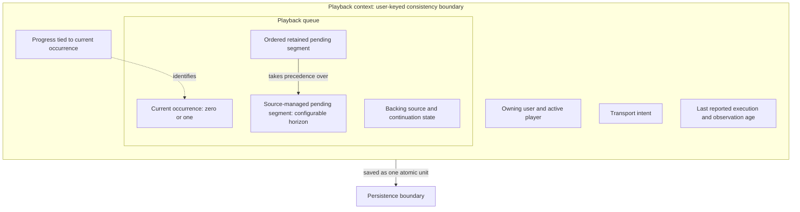
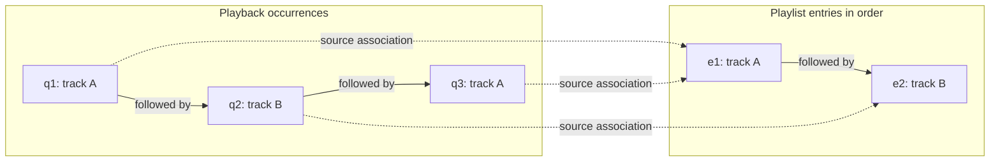
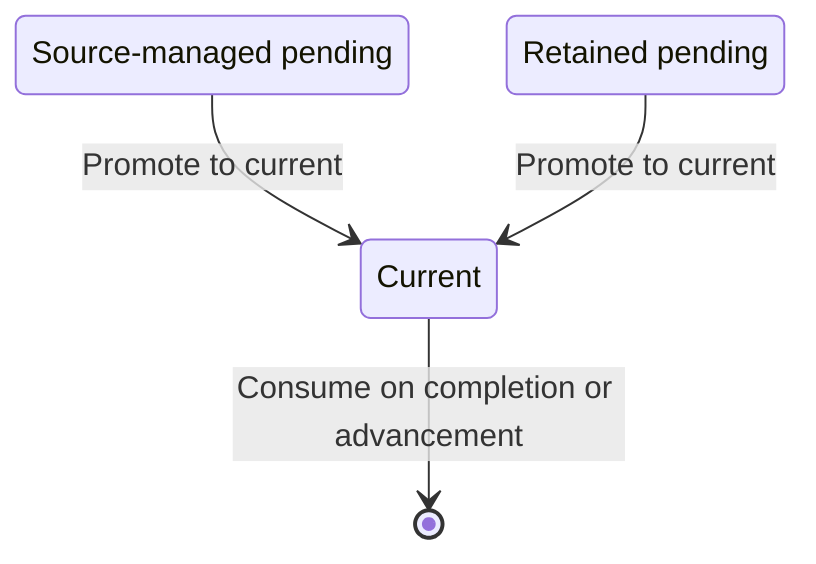
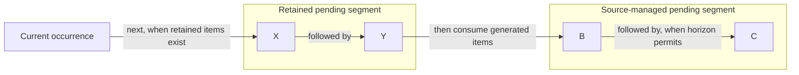
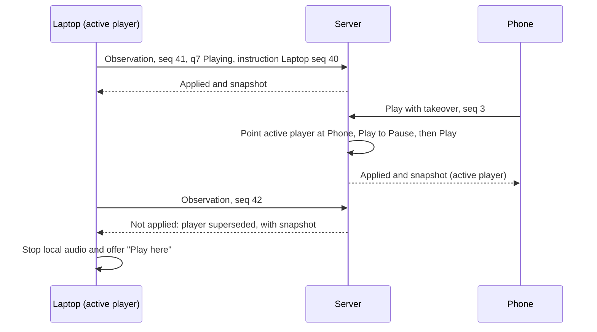
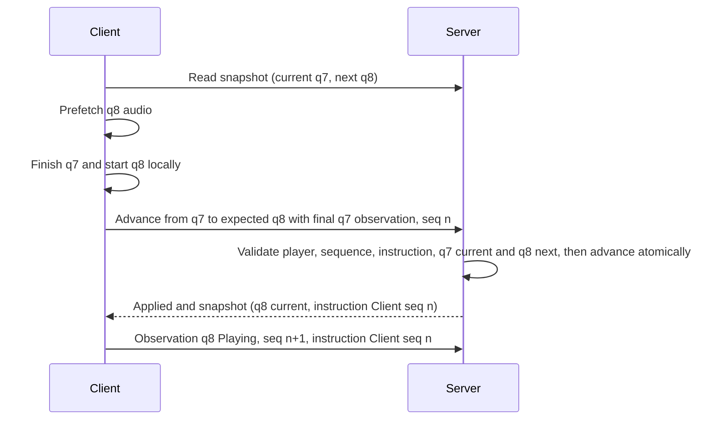

# Design

## Context

See [proposal.md](./proposal.md) for motivation and scope.

The HLD and concrete contracts are complete for planning review. Part 2, delta specs, and tasks define two implementation phases following the session foundation; none of those tasks is completed by authoring this plan.

This document has two parts:

1. **High-Level Design (HLD):** concepts, responsibilities, identities, invariants, and behavioral decisions independent of Java classes and persistence mappings.
2. **Refactoring Design:** verified current-code gaps and the eventual concrete mapping of the agreed HLD to application components, APIs, persistence, and verification.

There are no deployed databases, existing clients, or real data requiring compatibility. This refactoring makes playlists and playback contexts user-owned and builds on `introduce-client-sessions`, which resolves a client-supplied username to a stable user ID and issues per-instance session identity. Tracks and music sources remain shared. Username selection is unverified; authentication and authenticated authorization are not introduced here.

## Part 1: High-Level Design

### Goals / Non-Goals

**Goals:**

- Give each domain component a narrow, testable responsibility.
- Separate track identity, playlist membership identity, and playback occurrence identity.
- Treat the queue as a first-class playback sequence rather than a playlist projection or a collection restricted to playlist-backed tracks.
- Preserve current playback through source edits while explicitly reconciling eligible future choices.
- Keep queue, transport, and progress within one consistency boundary without duplicated authoritative state.
- Record confirmed decisions independently of unresolved cross-layer behavior.
- Keep each user's playlists and playback state independent while sharing track identity and music sources.

**Non-Goals:**

- Maintain old/new compatibility implementations or require a complete client during server implementation.
- Introduce authentication or authenticated authorization; support multiple simultaneous players for one playback context or remote-control clients that send commands without playing. Different users may play independently.
- Expose public queue-management endpoints, bespoke insertion APIs, or queue UI.
- Introduce a generic playlist-mutation language, additional reset/source-switch APIs, or advanced selection policies without a current use case.
- Choose a heap-based priority queue, locking strategy, persistence mapping, or final DTO shapes prematurely.

### Decisions

#### 1. Component responsibilities

| Component | Responsibility | Exclusions |
|---|---|---|
| Track | Identity, source, metadata, and availability/failure state shared across users. | User-owned playlist ordering and playback lifecycle. |
| Playlist entry | Stable entry ID referring to one registry track. | Independent metadata or playback progress. |
| Playlist | Owning user, name, ordered entries, and stored mode preference; membership/order invariants. | Active playback, queue generation, and transport. |
| Queue item | Playback occurrence ID, track reference, optional source association, and explicit occurrence policy. | Transport and position. |
| Playback queue | Current and ordered pending items, backing-source configuration, and continuation state; sequence management and source reconciliation. | Audio delivery, position, HTTP, repository access. |
| Source-sequence policy (working name) | Encapsulate generation, replenishment, and generated-item removal/replacement from supplied source and queue-owned continuation state. Return sequence updates for the configured generated horizon. | Independently authoritative mutable cursor, queue, or persistence. |
| Playback context | Owning user, active-player pointer, contained queue, transport intent, reported execution, and progress tied to the current occurrence; coordinate valid transitions. | A duplicate current-item reference or separate source cursor; assumptions that requested playback is physically running. |
| Application operations | Load required state, coordinate domain transitions and registry interactions, and save atomically with concurrency protection. | Controller-driven chaining or a second canonical memory copy. |
| Repositories/adapters | Persist and load aggregates and enforce the selected consistency strategy. | Choosing domain playback behavior. |



Containment expresses domain ownership; the dotted edge is a reference, not ownership or execution order. The persistence edge expresses atomicity, not a particular database mapping.

The queue is a full-fledged domain component but not a separately saved aggregate.

Alternative considered: a queue containing only pending items with current selection owned separately by the playback context. The richer queue is preferred because current selection, future sequence, and source continuation form one cohesive sequence-management responsibility. The playback context still owns transport/progress.

#### 2. Playlist identity and mutation

- Each playlist entry has a stable ID distinct from its track ID; multiple entries may reference the same shared track.
- Ordering is separate from identity. Moving an entry preserves its ID.
- Reorder is strictly a permutation of all existing entry IDs. It cannot add, omit, or repeat an entry. Membership changes are explicit.
- Selection, removal, and reorder address entry identities rather than ambiguous track occurrences.
- The playlist remembers a sequential/random preference. Playback interprets it; the playlist model must not depend on the playback implementation package.
- Each playlist belongs to a stable user ID. Create, list, read, mutate, delete, and materialize operations use the session's resolved user; callers cannot address another user's playlist through their current session.
- Playlist entries reference shared registry tracks. Catalog materialization creates an ordinary playlist for the requesting user, not a user-specific track registry.

Alternatives considered: track-addressed entries cannot distinguish duplicates; position-addressed identities do not survive reorder. Using reorder as replacement conflates membership and ordering.

Membership operations are explicit, preserve unaffected entry identities/order, and reconcile playback atomically. Concrete insertion payloads and positioning belong with API design; no generic combined-mutation language is required. Existing catalog materialization semantics remain an ordinary playlist snapshot rather than a special auto-updating source. Concrete command shapes and preference types belong in the refactoring design.

Stream source registration is a shared registry operation introduced by the session foundation. It returns track IDs, which callers may subsequently insert into their playlists. Playlist commands accept track references rather than resolving source URLs. Registration and insertion are separate operations: failed insertion does not undo valid registry entries.

#### 3. Queue occurrences are independent of playlist membership

A queue item carries its own occurrence ID and track reference. Its optional source association identifies a playlist and entry; that association does not determine whether the track is playable.

Repeated selection of the same entry creates different occurrences. A future bespoke item can lack a playlist association altogether.



Solid edges express order; dotted edges express optional source associations. The two occurrences of entry e1 remain distinct.

The queue model supports domain insertion, removal, clearing, and advancement even though public management APIs are excluded. See Decisions 9-11 for pending ordering, management, and explicit playback selection.

Alternative considered: infer all queue behavior from playlist membership. This prevents independent queued items and incorrectly couples current playback to an editable source.

#### 4. Explicit occurrence policies

| Policy | Meaning |
|---|---|
| Source-managed | Pending source-supplied item eligible for automatic reconciliation under the specific agreed mutation rules. |
| Retained | Pending item protected from automatic source reconciliation; explicit queue management may still remove it. |
| Current | Selected occurrence protected from pending-item rebuilds. |

Source association and policy are separate properties. Becoming current is a checkpoint transitioning either pending policy to current.



This diagram shows the confirmed promotion and consumption transitions, not a complete lifecycle. Explicit stop retains current selection; any future retention-policy editing operations remain outside this diagram.

The queue enforces consistency: at most one current item; any current item has current policy; pending items do not have current policy. Current policy does not imply playing transport: the selected item can be paused or stopped.

"Ephemeral" was considered but avoided because source-managed items are persisted, actual decided-ahead choices, not speculative previews. A random pick must not change merely because of reads or restart. Protection does not prevent completion, explicit advancement, or defined management operations.

Future UI can expose the distinction, but UI rendering and public pinning APIs are out of scope.

#### 5. Source-edit reconciliation

| Event | Current occurrence | Pending occurrences |
|---|---|---|
| Remove its source entry | Detach source association; preserve identity, transport, and position. | Detach retained associations and preserve occurrences; reconcile source-managed contribution through the policy. |
| Change source mode, order, or membership | Preserve occurrence, transport, and position; reconcile continuation. | Preserve retained occurrences/order; notify the policy to reconcile source-managed contribution. |
| Delete backing playlist | Detach source association; preserve playback. | Preserve retained occurrences detached; discard source-managed pending choices and clear source binding/continuation. |

Reconciliation targets entry association and policy, not track ID. Independent occurrences of the same track are unaffected by entry removal.

All playlist modifications invoke one source-reconciliation mechanism, delegated to the source-sequence policy. The policy owns preservation, regeneration, and replenishment of eligible choices, subject to the queue's protection and ordering rules. Callers notify it of the semantic operation; they do not implement mode-specific horizon repair themselves.

Mode changes occur only through playlist mutation, with ordinary owning-user access rather than active-player authority or playback-write sequencing. They reconcile the bound queue atomically without starting a new instruction. There is no separate playback-mode command or authoritative queue copy of the mode; the policy receives the loaded playlist's preference. Retained items preserve their relative order and form a segment ahead of source-managed items before and after reconciliation.

Pause affects transport, not sequence maintenance: queue operations and source edits reconcile normally while paused. While stopped, source edits still reconcile source binding/continuation state and the retained current item's association, but do not populate pending occurrences.

Alternative considered: make each caller repair generated choices after an edit. Rejected because selection and horizon maintenance must remain encapsulated and replaceable. Deleting a backing playlist does not implicitly promote generated choices to retained policy.

#### 6. Stable sequential continuation

When current playback loses its entry association, the queue retains a stable next-surviving-entry anchor rather than relying on the removed entry's numeric position.

```text
Before: playlist [e1:A, e2:B, e3:C]; current e2:B
Remove e2:
  playlist [e1:A, e3:C]
  current B, source association detached
  continuation anchor e3

Reorder to [e3:C, e1:A]:
  e3 remains next
  after e3, follow the latest playlist order
```

If the anchor is removed, advance it to the next surviving entry in the order immediately before that edit, wrapping as necessary. Evaluate a multi-entry removal as one mutation. If no entries survive, no valid anchor remains.

The anchor must survive clearing or rebuilding pending items. The point for resuming playback and the point for generating beyond already-prepared items must not be conflated. Their minimal persistence representation is a Part 2 decision. This example specifies detached sequential continuation, not universal preservation of generated successors across source edits.

Source continuation is independent of retained-item playback. Promoting a retained item, even one with a playlist association, does not reposition the source cursor or regenerate valid generated choices. Explicit play-from-entry is the operation that deliberately establishes a source starting point.

Stop/play of a detached selection preserves the bound source and reconciled continuation anchor. Play creates a new detached occurrence of the retained track and prepares source successors from that anchor, without reconstructing the deleted entry association or resetting to the playlist beginning.

If a bound playlist was empty and becomes populated with no surviving anchor, sequential continuation initializes at its first entry in the resulting order; random continuation selects from its available entries. Recovery preserves current playback and retained precedence and does not automatically start stopped playback. While stopped, initialize continuation without generating pending items.

Alternative considered: a numeric slot drifts under reorder/insertion and can unexpectedly change continuation; resetting to the first entry after removing an anchor can jump backward.

#### 7. Pause, stop, restart, and exhaustion

| Event | Current selection/occurrence | Pending items | Transport/progress |
|---|---|---|---|
| Pause | Preserve current occurrence. | Preserve. | Paused; preserve position. |
| Explicit stop | Retain track selection; end its active lifecycle. | Clear; do not replenish while stopped. | Stopped; position zero. |
| Play after stop | Restart retained track with a new occurrence identity. | Prepare a fresh sequence. | New playback starts at zero. |
| Completion with a successor | Consume completed occurrence; promote successor to current. | Replenish as appropriate. | Play intent; position zero; new instruction with execution initially Unconfirmed. Local gapless handoff avoids waiting at the audio boundary (Decision 15). |
| Completion without a successor | Consume completed occurrence; no current item. | Empty. | Stopped; position zero. |
| Fresh context | No current item. | Empty. | Stopped; position zero. |

Current selection can remain represented in the queue while stopped, but its ended occurrence cannot authorize reports after replay.

An empty source need not exhaust the queue: retained pending items can still be consumed. An empty queue with no current item is legitimate, including for a fresh installation. A configured empty source can remain attached.

Explicit stop and natural exhaustion are deliberately distinct. Reusing stop's retained selection for natural exhaustion would keep a fully consumed occurrence as current and is rejected.

Retained protection applies to source reconciliation, not explicit Stop: Stop intentionally clears all pending items, including retained ones. Exhaustion is valid independently of whether the initial sequential policy loops; empty/deleted sources or empty policy output can leave no successor.

#### 8. Canonical state and user-keyed boundary

Queue, transport, and progress have one canonical persisted representation and are updated within one playback-context consistency boundary. There must not be independently authoritative active-playlist, current-item, or cursor copies.

The queue's source is called the **backing playlist**, not the viewed or active playlist. UI browsing is not canonical playback state and does not change source binding.

The playback context is keyed by stable user ID, not username spelling. Session acquisition resolves or creates the user through case-insensitive username lookup after trimming and rejecting blank names (`introduce-client-sessions`). There is no implicit default user.

Sessions associated with the same user share that user's playlists and playback context, so switching player instances can continue the same queue and bookmark. Different users have independent playlists, queues, bookmarks, and active-player roles. Client sessions identify callers, not owners of playback state. The context points only to a session associated with its owning user (Decision 13).

All playlist access and playback binding use the session's resolved user. A context can bind only a playlist owned by that user. Membership and preference changes reconcile the owning user's context atomically; they do not reconcile another user's context merely because tracks are shared. Browsing does not acquire playback authority.

Tracks, metadata, availability state, and music sources remain shared. Registry cleanup must consider playlist and queue references across all users, including detached occurrences. Shared-track changes remain visible wherever that track is referenced.

This is state partitioning, not authenticated protection: anyone can acquire a session using another username and thereby select that user's state. Future authentication changes user resolution, not queue ownership; claiming existing unverified users needs an explicit future policy.

The exact repository-backed loading, state initialization, commit ordering, and concurrency strategy must be settled at the application/persistence layer. Queue-current transitions and progress resets cannot commit independently.

Each user has one canonical empty initial context: no current or pending occurrences, Stop intent, and position zero. Eager versus lazy persistence is a concrete choice; reads do not invent playback selections. Cross-user playlists are unavailable in the session user's scope and access fails explicitly. Exact API error mapping belongs in Part 2.

#### 9. Pending precedence and configurable generated horizon

Pending occurrences form two ordered segments: retained first, source-managed second. Retained items preserve their relative order through source changes and rebuilds. They are not anchored to generated items or absolute pending positions.



The generated horizon is configuration-based, with a default of 1. A single generated successor is the default operating shape, not a fixed domain invariant. The horizon applies to the source-managed segment, not current or retained occurrences; it is not a promise that the policy always returns that many choices.

The source-sequence policy handles generation/replenishment and responses to generated-item removal. The queue owns the persisted sequence and continuation state but does not embed sequential/random algorithms. This policy is a technical component, not a separately stateful service; the final name and interface remain refactoring decisions.

Generated occurrences are actual persisted choices. Reads, rendering, and restart do not reroll them. Valid choices survive retained-item promotion/playback; consuming a generated item into current triggers reconciliation of its segment. Explicit generated removal, pending clearing, and source changes also trigger policy reconciliation within the applicable queue mutation, not during a later read.

The component's contract accepts semantic operations and source changes and returns coherent source-managed sequence/continuation updates. Removal automatically leads to horizon reconciliation according to the policy; callers need no second repair command or selection fallback.

The source-managed segment may be empty. Current, retained, and generated portions can each be empty, including the entire queue. Empty policy output is handled by ordinary advancement/exhaustion rules, not classified as an error or silently replaced by caller-generated choices.

Use the simplest correct policy implementation and test its configured horizons, including values greater than one. Exact random/sequential selection, repetition, wrapping, and replacement mechanics are local implementation decisions, not additional behavioral specification requirements. Future focused policy changes must not require changes to queue callers or playback authority.

Alternative considered: fixed capacity of one. Rejected because it would turn a deployment default into a domain limitation. Ordinal placement of retained items was also rejected in favor of explicit retained-first precedence.

Part 2 must document the concrete initial policy and focused tests, not leave its behavior to implementor guesswork. Persisted stability excludes read/restart rerolls and retained-promotion rerolls; it does not make generated choices immune to semantic source changes. Such changes invoke the policy's documented reconciliation rules. Those local rules can evolve without changing queue callers or the playback protocol.

#### 10. Queue management and shared advancement

| Operation | Sequence effect |
|---|---|
| Remove a retained pending occurrence by occurrence ID | Remove that occurrence only; preserve remaining retained order. |
| Remove a source-managed pending occurrence | Delegate replacement/regeneration to the source-sequence policy; do not implement a queue-owned exclusion list. |
| Remove current | Invoke the same ordinary advancement transition as next; do not implement a separate current-removal selection branch. |
| Clear pending choices while playing | Remove retained pending items and regenerate the source-managed segment; preserve current playback, source binding, and source continuation. |
| Explicit stop | Retain current track selection, clear all pending items, and do not replenish while stopped. |

Removal/replacement of a generated item does not promise that the same track cannot be selected again. Random selection may choose it again; a one-entry source can only select that entry. Detailed multi-item replacement behavior belongs to the source-sequence policy.

Ordinary advancement consumes current and promotes the next available pending item, retained before generated. If no pending item or source candidate exists, current becomes absent. Completion and current removal reuse the sequence transition, while playback context handles occurrence validation, transport, and progress.

Clearing pending choices is not a command to finish current and then stop: source generation remains enabled while playing or paused. It also does not reset source continuation. Additional complete queue/source reset operations and public retained-insertion APIs are outside the current scope.

#### 11. Browsing, source binding, and play-from-entry

Viewing a playlist is read/render only and has no playback side effects. The backing playlist remains bound until an explicit playback operation changes it; binding does not forbid playlist edits.

An explicit **play from playlist entry** operation:

1. Identifies the playlist and desired entry.
2. Replaces current with a new occurrence of that entry at position zero and establishes Play intent; actual execution awaits client observation.
3. Binds that playlist as the source and establishes its continuation from the requested entry.
4. Preserves retained pending items in their existing order.
5. Rebuilds the source-managed segment using the playlist's mode preference and configured horizon.

The requested entry becomes current directly rather than waiting behind retained items. In sequential mode, generated successors follow that entry; in random mode, the explicitly requested entry still plays first and subsequent generated choices are random. The same rules apply when the playlist is already bound.

This separates an intentional playback operation from browsing and avoids silently discarding independent retained choices. A source-only switch without replacing current and a complete reset operation are not implicitly introduced by this decision.

#### 12. Transport intent and reported execution

Transport intent expresses the requested action: Play, Pause, or Stop. Reported execution expresses the latest applicable client observation, not a guarantee of present audio output.

| Execution state | Meaning |
|---|---|
| Unconfirmed | No applicable execution observation is available for the current instruction. |
| Preparing | Client is loading or preparing the occurrence. |
| Playing | Client reports playback advancing. |
| Paused | Client reports playback paused. |
| Buffering | Client reports waiting for data. |
| Stopped | Client reports playback stopped. |
| Failed | Client reports failure of this playback attempt. |

Intent and execution represent different facts, not competing sources of truth. For example, Play intent can coexist with Buffering or Failed execution. Issuing an instruction does not claim that the client has executed it.

Alternative considered: a single command-oriented transport state. Rejected because it cannot explain why requested playback is not progressing and conflates commands with observations.

#### 13. Active player, ordered playback writes, and canonical snapshots

The server owns desired playback state: queue, current occurrence, intent, and bookmark. The active player owns observations of its own execution. Each record has a single writer, and no protocol identifier has mixed client/server ownership.

| Identity | Minted by | Responsibility |
|---|---|---|
| User | Server | Stable ID resolved or created from a client-supplied username; owns playlists and one durable playback context. |
| Client session | Server (`introduce-client-sessions`) | Identifies one player instance; persisted. No separate player-instance ID is needed. |
| Active player | Server | The context's pointer to at most one client session allowed to issue playback writes. |
| Occurrence ID | Server | Identifies one playback occurrence independently of track or playlist-entry identity. |
| Request sequence | Client | Orders and deduplicates one client session's playback writes; monotonic for that session's lifetime. |
| Instruction reference | No separate allocator | The client session and request sequence of the applied command that established the current instruction. Attributes observations to that instruction. |
| Context revision | Server | Persisted ordering of committed context changes in snapshots; never a command precondition or instruction reference. |

Playback writes are playback commands and execution observations. They follow these rules:

- **Active player only, within the owning user.** The session's user determines the target context. Only its active player's playback writes apply. A command from another session of that user applies only if it explicitly requests takeover. Takeover atomically points that context at the caller, normalizes Play intent to Pause, preserves queue and bookmark, and then applies the command. Observations never take over. A session of another user addresses that other user's context, not this one.
- **Ordered by the client's request sequence.** Every playback write carries the session's next sequence. The server records the last applied sequence and a digest of its request per client session, in the same transaction as the resulting state change:
  - Higher sequence: evaluate authority, input, and operation-specific preconditions; apply only if valid.
  - Equal sequence with the same content: recognized retry, executed once only.
  - Equal sequence with different content: invalid input.
  - Lower sequence: stale, not applied.
- **Recognize applied retries before execution.** An equal-sequence, equal-content retry returns Already applied before reevaluating operation preconditions or executing takeover. It cannot reclaim the player role or advance twice. Rejected requests are not recorded as applied; an unanswered retry may apply later if its preconditions now match. Matching means operation-specific conditions, not equality of the entire snapshot.
- **Match relevant canonical state.** Commands carry the relevant expected state, including current occurrence/instruction when acting on that playback. A superseded target is not applied and returns the canonical snapshot. An unrelated field change need not invalidate a command. Clients reconcile normally; best-effort scheduling does not bypass preconditions.
- **Best-effort scheduling.** A client normally sends one playback write at a time and coalesces or drops unsent observations. A timeout leaves the outcome unknown, but does not block later writes. The client may retry an uncertain request if still relevant, resending identical content and sequence; a newer user action may supersede it without retry. Intermediate actions are not guaranteed delivery.
- **Occurrence- and instruction-checked observations.** Observations identify both the occurrence and their originating instruction. A callback retains that instruction reference even if it fires later and receives a newer request sequence. Observations for another occurrence or superseded instruction are not applied.
- **Canonical snapshot.** Every playback-write response and the playback read return the canonical playback snapshot, including whether the caller is the active player and the current instruction reference. A recognized retry returns the current snapshot, not a stored original response. Clients converge to the snapshot instead of reconstructing state from what they sent. Late responses must not overwrite newer snapshots or undo newer local user actions.
- **User-scoped access without takeover.** Reads, browsing, and playlist edits need a valid client session but not the active-player role, and never take over. They access only the session user's playlists and playback context; track data remains shared.

An **instruction** is the state established by an applied command that changes intent or the current occurrence, explicitly retries a failed attempt, or actually transfers active-player authority. Its reference reuses that command's client session and request sequence and is persisted with playback state; there is no separate instruction revision counter. A new instruction resets execution to Unconfirmed. A Play no-op without authority transfer preserves the existing instruction reference. Source edits that preserve current playback do not start a new instruction. Client-side callback filtering is useful, but server-side instruction validation is the correctness boundary.

An actual takeover includes deliberately claiming a context with no active player. It establishes exactly one instruction under the applying command's session/sequence, even if the resulting transport operation would otherwise be a no-op. Normalization and the command are one atomic transition, not two instructions. A redundant takeover flag from the already-active session follows normal command/no-op rules. Recognized applied retries never transfer authority again.

Snapshots expose a persisted, server-owned context revision for ordering committed context changes only. It is not an instruction identity, command precondition, or successor reservation. Reads and recognized retries return the current revision without incrementing it. Queue/source reconciliation and clearing an active-player reference are context changes and advance it. Part 2 must ensure contained updates advance the revision; a JPA version is a candidate, not an automatic guarantee.



Takeover is explicit rather than implied by any command, so a stale in-flight command from a displaced client cannot silently reclaim playback. A client learns from the snapshot whether it is the active player and requests takeover only on deliberate user action. Authority changes and the command are atomic; takeover cannot make an otherwise invalid command valid. Concrete command shapes express which deliberate actions request takeover; observations and data retrieval never do.

Alternatives considered:
- Server-allocated control revisions under a runtime-only control authority, plus client command IDs and per-revision observation sequences. Rejected: instruction attribution can reuse the applied command sequence, while persisted applied-request deduplication avoids restart-specific authority rules.
- A persisted global generation with compare-and-set on every write. Unnecessary once only the active player can change playback, because the session's request sequence already orders all of its writes.
- A dedicated player-session identifier. Redundant with the client session plus the active-player pointer.
- Persisted terminal outcomes for rejected requests. Rejected: retries intentionally reevaluate current preconditions; only applied requests require durable deduplication.
- Mandatory resolution of an uncertain write before sending another. Rejected: best-effort synchronization allows newer actions to supersede uncertain writes rather than blocking controls for guaranteed delivery.

#### 14. Playback commands and atomic checkpoints

| Operation | Occurrence/progress | Intent and queue |
|---|---|---|
| Play while intent is already Play | Preserve occurrence and bookmark. | No-op: no new instruction, same queue, including while preparing or buffering. |
| Play from Pause | Resume the same occurrence at the bookmark. | Play intent; preserve pending queue. |
| Play from Stop with retained selection | New occurrence of the selected track at zero. | Play intent; prepare pending items afresh from preserved source continuation. |
| Explicit play-from-entry | New occurrence at zero. | Play intent; bind source, preserve retained items, rebuild generated contribution. |
| Pause | Preserve occurrence and bookmark. | Pause intent; preserve queue. |
| Stop | Retain track selection and reset bookmark to zero; end active lifecycle. | Stop intent; clear pending items; no replenishment while stopped. |
| Manual Next or remove current | Consume current; select successor at zero when available. | Preserve prior Play/Pause/Stop intent. Exhaustion leaves no current and Stop intent. |
| Natural completion (advance) | Consume current; select successor at zero when available. | Play intent; exhaustion leaves no current and Stop intent. See Decision 15. |
| Retry failed playback | Preserve occurrence and last accepted position. | Preserve intent and pending queue. |

Every applied instruction-changing operation starts a new instruction and resets execution to Unconfirmed. A harmless repetition that changes no instruction need not manufacture a new playback attempt. Commands do not invent a current selection to satisfy a missing target; unsupported starting states fail explicitly. Retry continues failed execution, not an unrelated successful attempt. Concrete request guards and response mapping belong in Part 2.

Manual advancement while stopped can select from the source without leaving a populated pending segment. Later Play from Stop still starts a new occurrence of that retained selection.

Repeated Play does not reset server position. A client may seek or reset locally within the same occurrence and instruction, fetch the needed bytes, and report the discontinuity. Retry continues a failed occurrence; it does not replay from zero. If resumption is unavailable, the client can report a local reset after the retry.

Any playback command may carry a final observation of the instruction it ends. The checkpoint identifies that preceding occurrence and instruction; its instruction reference is not the new command's request sequence. The server validates applicability of both command and checkpoint before applying either, in one atomic operation under the command's request sequence. Pause retains that bookmark; Stop then resets it to zero. A superseded attached checkpoint prevents application of the request and returns canonical state for reconciliation; it is not ignored to apply a command against different playback. A malformed, negative, or numerically unrepresentable checkpoint rejects the whole request; exceeding advisory duration does not. No separate position-report request is required for correctness.

#### 15. Gapless handoff without reservations

The canonical snapshot already exposes the actual next occurrence (first retained, otherwise generated). Generated choices are persisted and reads never reroll them, so the client can prefetch the successor without a preparation request or a server-side authorization. Prefetched bytes do not count as playback.

At the audio boundary, the client starts the successor locally and sends one advance command. The command identifies the completed occurrence, its instruction, and the expected successor, and carries the final observation of the completed occurrence. The server applies it only if these preconditions still match canonical playback. The successor then becomes current with Play intent at position zero and an instruction reference derived from the advance command. Once confirmed, the client's next observation can report that instruction.



- **Queue edits.** A queue edit that leaves the successor unchanged does not affect the handoff. An edit that supersedes the successor makes the advance a conflict.
- **Rejected advance.** On rejection, the client stops the locally started occurrence and converges to the snapshot. It must not resubmit the stale playback as a new intent that overrides newer edits.
- **Retries.** An optional retry carries the same content and sequence, so an applied advance cannot execute twice. An unapplied advance reevaluates its preconditions. A timeout alone does not prove rejection.
- **No reporting before confirmation.** Successor observations wait for confirmation of its activation, through the advance response or a subsequent canonical snapshot. Unsent observations may be coalesced or dropped. An unanswered advance does not block a newer user command; stale successor observations must not be relabeled as belonging to that newer command.

A rejected advance does not invalidate the registry track or cached bytes. Track-data retrieval requires a valid client session (`introduce-client-sessions`), not the active-player role: fetching bytes is not a playback write and supports prefetching. External source disappearance or read failure is a separate availability error and must surface explicitly.

Alternatives considered:
- Conditional prepared revisions with server-stored authorizations. Rejected: they duplicate occurrence identity and need storage, expiry, and invalidation rules.
- Guaranteed successor reservations, or waiting for confirmation before the audible handoff. Rejected: they either weaken queue-edit semantics or add a network round trip at the boundary.

#### 16. Canonical position and bounded reporting

Client observations establish canonical position. Streamed bytes are neither a plausibility ceiling nor a position fallback; byte delivery cannot prove playback, and cached/prefetched audio breaks that inference.

- Accept nonnegative position when duration is unknown; do not invent a ceiling.
- Registry duration is advisory metadata, not an exact decoder-timeline ceiling. Accept nonnegative positions above it without rejection or bookmark clamping.
- Accept seeks forward/backward, including a local reset to zero.
- Position equal to duration is valid but does not infer completion.
- Preserve the last accepted bookmark when observations are absent; do not advance it from elapsed wall-clock time.
- Validate a combined execution/position observation as one unit. Invalid input changes neither execution/position nor the recorded request sequence.

Reports are bounded periodic playback checkpoints plus meaningful transition observations, not per-tick chatter. Include position with execution transitions where available rather than requiring duplicate requests. No periodic position chatter is needed while paused/stopped and unchanged.

Distinguish ordinary checkpoints from seek/local-reset discontinuities. Position indicates timeline location, not accumulated listening time. This preserves meaning for future server-side scrobbling without adding listening accounting, thresholds, or history storage now. Final Stop position describes where execution ended; the resulting zero bookmark describes where replay starts.

Cadence, numeric position representation, duration precision, and payload details remain refactoring decisions. No duration tolerance or special final-checkpoint exemption is needed. Structurally invalid or unrepresentable numeric input still fails explicitly.

#### 17. Execution failures and shared track diagnosis

Failed execution retains current occurrence, last accepted position, intent, and pending sequence. Failure does not consume the item or trigger automatic skipping. Recovery is explicit: Retry, Next, Stop, or play-from-entry.

Record structured occurrence/instruction-scoped error details, including category, message, and server receipt time. Exact categories and diagnostic retention remain refactoring decisions.

Execution failure does not automatically mutate shared track health. Client device/decoder/network failure and server-evidenced source failure are different diagnoses. Explicit track-failure operations and server scan/refresh checks remain separate. A new instruction's Unconfirmed execution must not display the previous attempt's failure as its own.

Alternative considered: auto-skip on failure or mapping client-error categories directly to shared track health. Rejected to avoid hidden sequence changes, unavailable-source loops, and global diagnoses inferred from local symptoms.

#### 18. Restart, takeover, silence, and retry safety

Server restart changes no playback state. The following all persist, so a client that kept playing continues to be accepted under its session and sequence:
- durable occurrences, pending choices, and source continuation
- bookmark and intent
- last observation and its receipt time
- active player
- current instruction reference
- per-session last applied request sequences and digests

Nothing is consumed, replayed, or rerolled because the server restarted. Play intent may remain alongside an aging observation. Its age indicates stale execution evidence, not proof that audio is or is not physically playing.

The protocol has no initialization step and no runtime-only state. Ordinary reads are side-effect-free. Explicit takeover (Decision 13) is the only operation that normalizes Play to Pause.

Client silence does not itself change playback state. Execution is exposed as the last observation with its server receipt time, so its age is visible. Session inactivity expiration is handled by the session lifecycle, not a playback heartbeat or lease. No inactivity Pause or elapsed-time listening inference is introduced.

Retry safety comes from the request sequence. The last applied sequence and request digest are recorded atomically with the state change, so a retry after a lost response, or after a server crash or restart, is recognized without a command-result cache, expiry policy, or separate commit coordination.

Synchronization is best-effort, not guaranteed command delivery. If a newer write applies first, an older uncertain write is stale and may never apply. Clients may abandon irrelevant retries and use subsequent writes and snapshots to reconcile. Local Pause/Stop need not wait for network resolution. Reacquiring an invalidated session does not silently replay an uncertain command under a new identity.

An expired or explicitly invalidated client session receives the session-required outcome (`introduce-client-sessions`). If it was the active player, its authority is ineffective immediately and the context has no active player until deliberate takeover. Preserve queue, intent, bookmark, instruction, and last observation; delayed physical cleanup cannot authorize writes. An already-open audio response is not terminated solely because the session expired.

Expiration/invalidation clears the stored active-player reference if it still points to that session. Do not retain a permanent stored-versus-effective authority distinction. Physical session deletion may follow later. Request-time expiration detection must enforce authority loss without waiting for the scheduler; delayed cleanup must never clear a newer player. The lifecycle transaction design belongs in Part 2.

Alternative considered: normalize Play to Pause on server restart and require fresh runtime control authority. Rejected because a server restart would pause audio the client is still playing, and runtime-only authority needs non-reuse and initialization-retry rules.

#### 19. Explicit request outcomes

| Situation | Outcome |
|---|---|
| Missing, unknown, or invalidated client session | Session required; no mutation. |
| New valid playback write from the active player, or a command with explicit takeover | Applied; canonical snapshot. |
| Recognized retry (same sequence and content) | Already applied; no duplicate execution; current snapshot. |
| Stale sequence | Not applied: superseded write; snapshot. |
| Observation for an occurrence that is not current | Not applied: superseded playback; snapshot. |
| Observation for a superseded instruction, even if the occurrence is still current | Not applied: superseded instruction; snapshot. |
| Playback write from a session that is not the active player, without takeover | Not applied: player superseded; snapshot. The client stops local audio. |
| Advance whose completed occurrence, originating instruction, or expected successor no longer matches | Conflict; no transition; snapshot. |
| Command's expected playback or attached checkpoint references superseded state | Conflict; no command or checkpoint mutation; snapshot for reconciliation. |
| Malformed, negative, or numerically unrepresentable position, other invalid input, or a reused sequence with different content | Invalid input; no mutation. An invalid attached checkpoint rejects its whole command; advisory duration is not a bound. |

These are domain/protocol outcomes, not selected HTTP status codes or DTOs. Stale activity is explicitly acknowledged as not applied, never as a success-shaped state mutation. Every outcome except session-required and invalid input carries the canonical snapshot for reconciliation. Rejected writes do not update the last applied sequence/digest; an unanswered retry reevaluates current preconditions. After a definitive rejection is received, a deliberate new attempt uses a new sequence.

"Does not apply" describes a mutation effect, not another outcome. Use Not applied for stale sequences, superseded observations, or absent authority; Conflict for otherwise eligible commands whose expected state/checkpoint no longer matches; Invalid input for malformed/unrepresentable values or sequence/content reuse. Advisory duration does not make a position invalid.

### Risks / Trade-offs

- [Occurrence policy and current slot can contradict each other] -> Enforce both through queue transitions; callers cannot freely assign incompatible policy/placement.
- [Rebuild changes explicit-item precedence unexpectedly] -> Preserve the ordered retained-first segment and rebuild only eligible generated choices.
- [Detached occurrences outlive playlist references] -> Treat queue references as meaningful independently of source membership; concrete cleanup protection belongs in the refactoring design.
- [One user's playlist operation reads or changes another user's state] -> Scope lookup, mutation, playback binding, and reconciliation by the session's stable user ID.
- [Shared-track cleanup overlooks another user's references] -> Evaluate references across all user-owned playlists and playback queues, including detached occurrences.
- [Random look-ahead becomes unstable] -> Persist decided picks and preserve them except for explicitly defined reconciliation events.
- [Source anchor and generation cursor skip or duplicate successors] -> Specify playback continuation and replenishment independently, then minimize redundant stored state.
- [Delayed callbacks describe a superseded attempt of the same occurrence] -> Validate both occurrence and originating instruction, independently of the observation's newer request sequence.
- [Gapless local handoff races with source edits] -> Advance validates the completed and expected successor occurrences; the client stops and converges to the snapshot on rejection.
- [Lost responses duplicate non-idempotent transitions] -> The last request sequence and digest are recorded atomically with each transition, so retries are recognized, including after restart.
- [A displaced or stale client keeps driving playback] -> A single active-player pointer; other sessions' playback writes are rejected unless they explicitly take over.
- [Uncertain writes delay controls or are mistaken for confirmed failures] -> Best-effort scheduling permits newer actions after timeout; reconcile unknown outcomes without mandatory retries or guaranteed intermediate delivery.
- [Late responses overwrite newer client state] -> Coordinate response handling so older snapshots and acknowledgments do not undo newer snapshots or local user intent.
- [Queue and progress are persisted independently] -> Keep them inside one transaction and concurrency boundary.
- [Settled HLD is mistaken for implementation readiness] -> Keep concrete refactoring design separate; specifications/tasks remain unwritten until the next planning stage.

### HLD Completion Gates

None remain for the current HLD scope. Part 2 supplies concrete contracts; speculative queue APIs and generic mutation facilities remain excluded.

## Part 2: Refactoring Design

This maps the agreed HLD to a selectively reset application. The concrete implementation contract below resolves the earlier draft questions; use it with delta specs and phase-scoped tasks.

### Current Implementation Context

- `Playlist` holds track IDs rather than entry identities and imports the playback domain's mode type.
- `PlaylistService` independently holds an active playlist ID, while `PlaybackService` holds another in a mutable session and writes state after mutating memory.
- Sequential selection uses the first matching track ID, making duplicate occurrences ambiguous. Sequential look-ahead deduplicates track IDs; random look-ahead does not expose successors.
- Playlist mutation does not reconcile playback. Playlist mode updates and playback mode updates can diverge. Active-playlist deletion has a persisted playback reference but no coordinated detach operation.
- Playback position and stream observations identify tracks, not occurrences; a repeated track cannot distinguish delayed activity from its previous playback lifecycle.

### Execution Prerequisite and Phase Ownership

The [session refactoring design](../introduce-client-sessions/design.md#part-2-refactoring-design) owns Phase 1 (including the entire initial selective reset), and [replace-jmolecules-with-vertical-slices](../replace-jmolecules-with-vertical-slices/design.md) owns Phase 1.5 (removing jMolecules, enforcing vertical package slices and horizontal purity with plain ArchUnit, collapsing 1:1 repository adapters with package-private `*Converter` classes, and switching scan reference lookup to `List<ReferencedTrackIdsPort>`). This change begins from that verified Phase 1.5 baseline, not a partially adapted old player. Do not restore old initialization, track-addressed playback, singleton state, jMolecules annotations, or compatibility routes.

| Phase | Implement here | Intentionally absent at its boundary |
|---|---|---|
| 2. Playlist and queue foundation | User-scoped playlist operations; stable entry/occurrence identity; queue/source policy behavior; contained context mapping/persistence; atomic playlist reconciliation; all-user registry-reference queries. | Public playback command/observation protocol, active-player coordination, gapless confirmation, and proactive upcoming refresh scheduling. |
| 3. Playback protocol and integration | Transport/execution transitions; authority/takeover; sequence/digest and instruction attribution; canonical API snapshots; session lifecycle coordination; upcoming refresh integration and client contract verification. | Authentication, speculative public queue APIs, guaranteed delivery, scrobbling/accounting, and other HLD non-goals. |

Each phase is scoped for human review and meaningful behavioral verification, progressing from pure domain behavior to cross-layer coordination. A complete player is not required at the Phase 2 boundary. Compilation, application startup, tests, and preservation of retained functionality are required.

The session change owns removal; this change owns replacement. Assign any overlooked dependency explicitly rather than distributing unowned cleanup across tasks.

### Phase 2: Domain and Persistence Foundation

#### Component and package mapping

Retain `registry` as the shared track slice and `session` as the caller/user slice. Rebuild `playlist` and `playback` as enforced vertical package slices following Phase 1.5's horizontal package conventions (`model`, `service`, `repository`) without jMolecules annotations. Keep presentation contracts in `api` and entities/stores in `persistence`. Working names below express responsibilities, not mandatory class counts or final signatures.

Follow the requirement-delta ownership table in the session design when authoring specs; playback owns all playback-control changes and the correlation lifecycle terminology.

Playback correlation follows occurrence lifecycles, not shared track identity: replay after Stop creates a new occurrence/lifecycle; pause/resume/seek within one occurrence retain the playback lifecycle. Source preference edits are playlist operations, not phantom playback-mode commands, and browsing is not an active-playlist switch. Preserve request `CorrelationId` propagation. Exact revised scenario wording belongs in this change's observability delta; no browser implementation is implied.

| Component | Implementation responsibility | Boundary to preserve |
|---|---|---|
| Playlist entry / playlist model | Stable entry ID, shared track reference, owning user, ordered membership, name, and playlist-owned selection preference, plus domain events (`PlaylistSourceChanged`, `PlaylistDeleted`). | No active-player/transport state; reorder is not membership replacement; `playlist` never depends on `playback`. |
| Playback occurrence | Independent occurrence ID, track ID, optional playlist/entry association, and placement-compatible policy. | Never identify occurrences by track ID or numeric playlist position. |
| Playback queue | Current/retained/generated segments, backing source, and durable continuation. Semantic mutations enforce protection/ordering and invoke source reconciliation. | No repository I/O, HTTP, second current reference, or independently saved aggregate. |
| Source-sequence policy | Concrete `@Component` performing pure transformation of supplied source, generated choices, semantic change, continuation, and horizon into coherent updated sequence/continuation. | No 1:1 pass-through interface, hidden mutable cursor, database access, or caller-side repair. Selection mechanics remain local. |
| Playback context | User-keyed consistency boundary for queue and transport/progress facts. Phase 2 establishes representation and queue integration. | Phase 3 owns externally callable playback transitions and authorization; no temporary permissive commands. |
| Playlist application operations & playback listener | `PlaylistService` scopes commands by resolved user, locks user/tracks, mutates playlist, and publishes synchronous `PlaylistSourceChanged`/`PlaylistDeleted` events; `PlaybackSourceReconciliationListener` (`@EventListener` in `playback/service`) reconciles the user's context atomically in the same transaction. | Controllers do not chain independently committed mutations; `playlist` remains decoupled from `playback`. |
| Concrete domain repositories | Load/save owned playlists and whole contexts under the selected concurrency strategy, exposing only domain records while encapsulating `persistence` stores/entities. | No 1:1 `Jpa*Repository` pass-through interfaces; queue tables do not create separate authority. |
| Registry reference providers | `PlaylistRepository` and `PlaybackContextRepository` implement `ReferencedTrackIdsPort` directly so `LibraryScanCoordinator` unions references from all users' playlists and all queue segments via `List<ReferencedTrackIdsPort>`. | No cross-slice adapter in `registry/scan`, requesting-user filter, or omission of detached/current/retained references. |

Persist queue-bearing contexts through the context repository, not a temporary standalone queue store. Establish canonical empty-context and transport/progress representation needed for coherent persistence; Phase 3 extends this with reviewed protocol storage. Reads never synthesize a playable selection.

Queue/source tests use plain domain values, including constructed current/retained/generated states. Fixtures require neither public insertion APIs nor a fake playback service. Source edits receive enough before/after entry information to reconcile a multi-entry mutation as one operation.

Use the simplest correct sequential/random implementation. Test empty output, horizons greater than one, stable stored choices, retained precedence, and semantic-operation-triggered reconciliation. Keep algorithm mechanics local, not new behavioral requirements. HLD Decision 6's agreed stable continuation behavior still applies; select its minimal representation without duplicate authoritative cursors.

#### Persistence and atomic mutation

Introduce stable entry/occurrence keys separate from order columns. Persist user ownership, playlist preference, context identity, actual decided occurrences, associations, segment policies/order, and continuation; tracks/metadata remain shared. The concrete contract below specifies mappings, constraints and initialization.

Removal/reorder preserves unaffected entry IDs; saves must not recreate identities. Optional source associations allow detachment and backing-playlist deletion without deleting selected/retained occurrences. Relational queue tables, if used, are saved exclusively through the context boundary. Verify real JPA/Flyway collection updates, not only in-memory behavior.

Playlist membership/order/preference changes or deletion and context reconciliation commit together. Neither half survives a failure. Shared tracks do not cause another user's context to reconcile. Playlist/context writers need a common lock/order strategy to prevent stale source choices; choose it before implementation.

Reference protection becomes operational here, when durable references return. Query current, retained, and generated occurrences plus entries across all users. Scanner deletion racing with creation of a reference needs an explicit consistency strategy; a reference query followed by deletion is not automatically race-safe.

#### Phase 2 acceptance and handoff

- Reviewed user-scoped playlist create/read/list/update/membership/reorder/delete/catalog contracts work; foreign-user resources fail explicitly.
- Duplicate tracks remain distinct entries/occurrences through domain transitions and persistence round trips; reorder preserves membership/identity.
- Context persistence preserves actual choices/continuation. Reads/reload do not reroll; empty contexts/segments are valid.
- Source changes preserve current/retained occurrences, detach correctly, and reconcile automatically, including paused/stopped fixtures.
- Real persistence/application tests prove atomic rollback, ownership isolation, and all-user reference protection.
- Application startup and retained registry/streaming/session/health/correlation behavior remain verified; no public playback API is required.
- Phase 3 receives tested domain boundaries, whole-context repository contracts, mappings, and the shared transaction strategy.

### Phase 3: Playback Protocol and Integration

#### Application and presentation boundaries

Extend context transport/execution behavior and introduce a cohesive playback-write application boundary. Coordinate validity/authority, sequence recognition, command/checkpoint applicability, domain transitions, persistence, and canonical projection. Extract pure validation/transformation responsibilities where useful; avoid a multi-concern controller or monolithic service.

Presentation DTOs use Bean Validation and map to application commands. User/session identity comes from validated caller resolution, not a caller-supplied ownership field. Controllers route and translate status; application operations own transactions. Reads do not select, refill, take over, or initialize runtime state.

The concrete contract's Playback API and applicability table below is authoritative for expected-state fields, checkpoint constraints, allowed starting states, takeover support, instruction effects, and domain outcome/HTTP mapping. It resolves HLD Decisions 12-19; implementation verifies this table rather than reopening those decisions.

The core write transaction must:

1. Coordinate persisted session validity and user/context ownership under the selected lock boundary.
2. Recognize applied retries before operation preconditions or takeover; return the current snapshot without executing again.
3. Reject stale/reused-content sequences, invalid authority, superseded relevant state, or invalid command/checkpoint as prescribed by the HLD.
4. Validate the entire command/checkpoint before mutating either. Takeover cannot make stale evidence applicable.
5. Apply a valid checkpoint and transition, including takeover effects, atomically. Establish/reset instruction/execution only when required.
6. Commit context and last-applied session sequence/digest in one transaction, without in-memory authority or a second commit.
7. Project outcome and snapshot from coherent canonical state; session-required/invalid-input exceptions use the reviewed response contract.

Rejected requests do not persist terminal outcomes. Unknown-result retries may reevaluate preconditions; later applied sequences may supersede them. Do not add result caches, instruction revision allocators, reservations, or forced retry-before-next-write. The ordering-only context revision is separate from instruction attribution and command applicability.

#### Session validity and persistence coordination

Complete the lifecycle integration intentionally absent in Phase 1. Invalid/expired active sessions are immediately ineffective, with no active player exposed even before cleanup. Invalidation and playback writes must serialize safely while preserving queue, bookmark, intent, instruction, and observation.

Persist active-player identity and instruction with context, and applied sequence/digest per client session. Historical instruction attribution is a pair of values, not proof that its originating session remains alive. Cleanup constraints must allow the session row to disappear without deleting playback facts. Renewal must not overwrite deduplication state. Verify these storage invariants with focused persistence tests; dedicated concurrent-interleaving integration tests are deferred.

Restart loads durable facts without initialization or normalization. Expiration is not Pause/Stop; explicit takeover alone applies its agreed normalization before its command.

#### Retained integration seams

| Integration | Phase 3 responsibility | Outside playback |
|---|---|---|
| Upcoming refresh | Include all users' contexts with current occurrence and Play/Pause intent. Take current then actual pending occurrences, up to the configured count per context; deduplicate by shared track ID in the playback-to-refresh integration before invoking the refresh service. | Planner/service/refresher retain selection-independent timeout/retry/failure responsibilities. |
| Track/audio retrieval | Use Phase 1 session-valid media access for prefetch/ranges, without an active-player requirement. | Byte delivery never establishes position/execution. |
| Shared-track diagnosis | Preserve explicit failure and scan/refresh operations. | Occurrence/instruction execution failure does not automatically mark a shared track failing. |
| Client-facing protocol | Implement attribution, snapshots, optional retry semantics, and successor confirmation; verify server contracts without a client. | Client implementation, local response ordering, and audio execution are deferred. |

Upcoming selection preserves occurrence order/duplicates. Coverage per eligible context is the minimum of configured count and actual current-plus-pending size. Default horizon one commonly gives two occurrences, not ten; this accepted reduction must appear in the audio-streaming delta. Never generate preview choices to fill the refresh count. Stop contexts are excluded and rely on request-time refresh. Final projection/adapter names remain concrete design work.

No client will be built in these changes: it is deliberately deferred until the API and workflow settle. Server delivery is complete at its reviewed API boundary, not at an end-to-end browser-player boundary. MockMvc verifies the handoff protocol, not audible gaplessness or local response ordering; those belong to future client work.

#### Phase 3 acceptance

- Commands/checkpoints obey the applicability table without partial mutation or stale-checkpoint bypass.
- Equal-content applied retries do not advance twice or reclaim authority; unknown outcomes permit later actions.
- Same-user sessions explicitly take over; different users remain independent. Stale occurrence/instruction reports and invalid sessions cannot write.
- Position/failure behavior follows nonnegative/representable-input validation, advisory duration, discontinuities, and no-extrapolation rules. Execution failure does not consume the queue or alter global diagnosis.
- Restart preserves choices, validity-dependent authority, instruction, sequence/digest, bookmark, intent, and observation age.
- Gapless advance validates current/instruction/successor identity; conflict returns canonical state rather than reserving/adopting speculative audio.
- Proactive refresh uses actual upcoming choices; request-time refresh and retained scan/streaming/health/correlation behavior remain intact.
- Normal-use client-facing workflows pass `@SpringBootTest`/MockMvc integration tests with real services/persistence. Client implementation and browser verification are not completion gates for these changes.

### Implementor Context and Task Structure

Design/specs must stand alone without conversation history. Later tasks group Phase 2 and Phase 3 with prerequisites, review gates, and handoffs. Each task/group links relevant contracts, names concrete production/test surfaces, states required behavior/exclusions, and specifies measurable verification/completion.

Start with isolated domain rules, then mappings/application atomicity, then presentation/protocol integration. Use real domain values; repository mocks must not simulate JPA filtering/persistence. Preserve unaffected tests instead of disabling suites to hide incomplete integration.

Tasks must not merely say "implement queue" or "update playback"; identify the identity/ordering/transition contracts and regression cases. Reference authoritative HLD sections rather than duplicating them throughout tasks. Missing decisions affecting contracts, phase scope, or atomicity block implementation rather than becoming implementor discretion.

### Execution Risks / Trade-offs

- [Reset deletes useful behavior with obsolete setup] -> Follow the session inventory and preserve unaffected mixed-test assertions.
- [Phase 2 creates competing queue authority or permissive playback API] -> Save through context and test domain operations without public playback wiring.
- [Green build is mistaken for complete functionality] -> Verify phase behavior/absences and retain final integration gates.
- [Session renewal/cleanup races with playback commit] -> Finalize shared locking before tasks and retain focused validity/atomicity tests; dedicated interleaving harnesses are deferred.
- [Implementor fills design gaps with incompatible assumptions] -> Resolve blockers and link explicit contracts/tests; stop on contradictions.

### Migration Plan

Phase 1 removes obsolete structures; Phase 2 introduces playlist/context schema; Phase 3 extends protocol state. Revise the initial Flyway schema and entity mappings together with Hibernate validation. No transitional models or data converters are needed.

Document explicit disposable-development-storage recreation at schema boundaries; never automatically erase the configured database. Preserve a known verified source revision before reset. Rollback uses source history and explicit disposable-database recreation, not production downgrade.

Update directly affected documentation at implemented review boundaries to expose intentionally missing capabilities. Final architecture docs describe the completed design, not removed APIs. These are later implementation edits, not additional exploration scope.

### Verification Strategy

Phase 2 prioritizes plain domain tests, real JPA/Flyway mapping tests, and focused atomicity/ownership tests. Phase 3 adds protocol/API contract tests and normal-use integration workflows. Explicitly cover duplicates, detached references, empty states, and horizons greater than one.

The outer verification surface is `@SpringBootTest` with MockMvc, exercising real services and persistence from a caller's perspective. Reuse the session change's [shared audio fixtures and integration library setup](../introduce-client-sessions/design.md#shared-audio-fixtures-and-integration-library-setup): copy short, valid tagged resource files into an isolated temporary library and run the real scanner into rollback-managed in-memory H2 with background scanning disabled. This library preparation is the allowed test setup boundary; do not directly seed playlist/playback state. Build stories through public operations and returned identifiers/snapshots:

- Acquire a session, create/populate a playlist, play from an entry, and report execution.
- Seek by reporting a position discontinuity for the current occurrence/instruction, then pause and resume using the bookmark.
- Read the actual upcoming occurrence, retrieve its audio, submit Advance with completed/current instruction and expected successor, and report successor execution after confirmation.
- Edit/reorder the backing playlist while current playback remains selected.
- Stop and replay, verifying a new occurrence and zero bookmark.
- Acquire another same-user session and deliberately take over; use a different user to verify independent ordinary workflows.

Use focused unit/application/persistence tests for applicability, deduplication, bounds, validity, ownership, and atomicity. Do not make the outer integration suite an exhaustive guard matrix. Dedicated race orchestration, interrupted-network/mid-response failures, adversarial or rogue intent, and restart-process fault harnesses are deferred to separate work. Persistence round trips still verify durable facts, and the chosen concurrency/failure contracts remain implementation requirements.

These tests verify protocol handoff and canonical state, not actual sound, browser callbacks, or audible gaplessness. No client implementation is required.

Use existing strict Mockito conventions where appropriate, `@DataJpaTest` for mappings, and transactional rollback for database-writing integration tests. Keep domain rules framework-free, controllers presentation-only, and mutations atomic. Architecture rules, retained tests, formatting, and coverage remain active.

After Java formatting, each phase passes `mvn clean test` and `mvn clean verify`. Container-sensitive changes receive Dev Container verification. Review actual behavior, not only compilation or framework wiring. Tasks remain unchecked until implementation.

### Concrete Implementation Contract

All Java paths are relative to `src/main/java/com/gravifon/player/`; test paths mirror these below `src/test/java/com/gravifon/player/`. Domain records are plain Java. Use existing Spring/JPA transactions, locks, MVC/validation and scheduled execution, not custom lock registries or generic mutation frameworks. No new dependency is required.

#### Named domain and application types

| Phase / create | Key contract |
|---|---|
| 2: `playlist/model/PlaylistId`, `PlaylistEntryId`, `PlaylistEntry`, `SelectionMode`, `Playlist`, `PlaylistSourceChanged`, `PlaylistDeleted` | String ID records; entry has entryId/trackId; playlist has id/userId/name/ordered entries/mode. `SelectionMode` is `SEQUENTIAL` or `RANDOM`, owned by playlist. Rename, strict reorder, insert-before, and removal preserve unaffected entry IDs. `PlaylistSourceChanged` and `PlaylistDeleted` are immutable domain events published on playlist mutation/deletion. |
| 2: `playback/model/OccurrenceId`, `SourceAssociation`, `OccurrencePolicy`, `QueueItem` | Occurrence string ID; association playlistId/entryId; policy `CURRENT`, `RETAINED`, `SOURCE_MANAGED`; item carries occurrenceId/trackId/nullable association/policy. |
| 2: `playback/model/PlaybackQueue`, `Continuation` | Current nullable, retained/generated ordered lists, nullable backingPlaylistId, continuation's nullable nextEntryId. Semantic `insertRetained`, `remove`, `clearPending`, `advance`, `bindFromEntry`, `reconcileSource` methods return coherent queue state and invoke policy internally. |
| 2: `playback/model/SourceSnapshot`, `SourceChange`, `SourceSequenceUpdate`, `SourceSequencePolicy` | Plain before/after entry/mode snapshots; typed semantic changes carry affected/consumed occurrence when needed, rather than only an enum without payload. Result carries generated choices/continuation. `SourceSequencePolicy` is a concrete `@Component` (no 1:1 interface) with `reconcile(before, after, generated, continuation, change, horizon, occurrenceIds)`. Inject `RandomGenerator`; no repository/HTTP. Keep domain method input/result behavior testable without Spring. |
| 2: `playback/model/TransportIntent`, `PlaybackContext` | Intent `PLAY`, `PAUSE`, `STOP`. Context owns userId/queue/intent/positionMs/revision; Phase 3 extends with authority/instruction/execution. Position belongs to current, not duplicate currentTrackId. |
| 2: `playlist/service/PlaylistService`, `playback/service/PlaybackSourceReconciliationListener` | `PlaylistService` provides atomic create/catalog/update/insert/remove/reorder/delete operations, taking explicit userId and dedicated application command records, saving the playlist, and publishing synchronous `PlaylistSourceChanged`/`PlaylistDeleted` events; `PlaybackSourceReconciliationListener` (`@EventListener` in `playback/service`) reconciles and saves the user's `PlaybackContext` in the same transaction. |
| 2: `playlist/repository/PlaylistRepository`, `playback/repository/PlaybackContextRepository` | Concrete `@Repository` classes exposing only domain records (with domain $\leftrightarrow$ entity translation encapsulated in package-private `PlaylistConverter` and `PlaybackContextConverter`): user-scoped find/list/save/delete for playlists; context `findByUserId` and `save`. Both implement `ReferencedTrackIdsPort` directly so `LibraryScanCoordinator` collects all users' playlist-entry and queue-item track IDs via `List<ReferencedTrackIdsPort>`. No public queue repository. |
| 3: `playback/model/InstructionRef`, `ExecutionState`, `CheckpointKind`, `ExecutionFailure`, `ExecutionObservation` | Instruction(sessionId,positive long sequence); execution `UNCONFIRMED`, `PREPARING`, `PLAYING`, `PAUSED`, `BUFFERING`, `STOPPED`, `FAILED`; kind `PERIODIC`, `DISCONTINUITY`, `TRANSITION`. Observation carries occurrence/instruction/state/positionMs/kind/nullable failure/server receipt time. |
| 3: `playback/model/PlaybackCommand` and dedicated command records | Operation-specific inputs; no nullable mega-command or reflective dispatch. `ExpectedPlayback` describes current occurrence/instruction/intent, including explicit empty-current state. |
| 3: `playback/service/PlaybackService`, `PlaybackWriteCoordinator`, `PlaybackRequestDigest` | Read facade, transactional write orchestration, pure canonical digest. Separate transition logic in context/domain from persistence/protocol orchestration. |
| 3: `playback/repository/PlaybackWriteStateRepository` | Concrete `@Repository` class (with package-private `PlaybackWriteStateConverter`) managing per-session applied sequence/digest, saved with context; rejection stores nothing. |
| 3: `playback/service/PlaybackAuthorityLifecycleListener` | Synchronous session invalidation event handler; joins publisher transaction, conditionally clears matching stored pointer, saves context/revision. |
| 3: `streaming/UpcomingTrackRefreshAdapter`, `StreamRefreshScheduler` | Add eligible-upcoming projection to `PlaybackContextRepository`, project real eligible context occurrences, deduplicate tracks, feed retained refresh service. No preview selection or queue mutation. |

Use explicit constructors/transformations; domain invariants reject invalid direct calls instead of null dereferences. Presentation request records are not application commands. UUID strings mint new entry/occurrence IDs; a reorder never mints IDs. Use `String` track IDs consistently across playlist entries and queue occurrences without duplicating registry models.

#### Initial policy mechanics (local implementation, not extra behavioral specs)

Sequential loops through current source order. Continuation stores the next source entry to consume, independent of retained playback. Generate horizon entries from that point, wrapping if needed; occurrences remain unique even when entries repeat. Refill after consumed generated choices extends from the last surviving generated entry; if none survives, start from nextEntryId. Promoting a generated entry moves continuation to its following source entry. Promoting retained items changes neither continuation nor valid generated choices.

On order/membership/mode changes, sequential generated choices are rebuilt from the reconciled continuation. Preserve a surviving next-entry anchor; if removed, use the next survivor in pre-edit order. Do not derive this anchor from current: current may have been promoted from retained items, which must not reposition source continuation. Empty-to-populated initializes first entry. A mode change into sequential follows those same anchor rules. Rename alone preserves generated choices.

Random uses independent uniform entry picks, repeats allowed. Preserve already-decided choices on reorder/insertion/rename; remove choices whose entry disappears and fill the missing horizon. A mode change rebuilds generated choices. Random retains/reconciles the next-entry anchor for a later sequential preference change, but does not use it for random picks.

Explicit generated removal deletes that occurrence then refills; it is not an exclusion list and may select the same entry again. Stop clears pending without populating it; manual Next while stopped uses one temporary policy candidate to select current but persists no pending segment. Source deletion detaches current/retained associations and clears source/generated/continuation. These details stay local to policy tests and can be revised without queue-caller changes.

Configure `PlaybackProperties(@Min(1) int generatedHorizon)` at `gravifon.playback.generated-horizon: ${GRAVIFON_GENERATED_HORIZON:1}` and `PlaylistProperties(@NotNull SelectionMode defaultMode)` at `gravifon.playlists.default-mode: SEQUENTIAL`. Defaults remain YAML-only; omitted create mode uses the configured preference (the shipped default is SEQUENTIAL). Inject random/id sources for deterministic tests. Test with the generated horizon configured to 3: this targets three source-managed pending occurrences, excluding current and retained items, to exercise multi-choice reconciliation rather than only the shipped default of 1. Empty output remains valid under the agreed policy contract. Also test duplicate entries, detached/reordered anchor, and preserved random choices.

#### Persistence schema and mapping

Phase 2 adds these tables to the initial schema; Phase 3 adds the explicitly marked context columns and write-state table. Keep Hibernate validate.

```sql
CREATE TABLE playlist (
    id VARCHAR(36) PRIMARY KEY,
    owner_user_id VARCHAR(36) NOT NULL REFERENCES app_user(id),
    name VARCHAR(255) NOT NULL,
    selection_mode VARCHAR(16) NOT NULL,
    created_at TIMESTAMP WITH TIME ZONE NOT NULL,
    updated_at TIMESTAMP WITH TIME ZONE NOT NULL
);
CREATE TABLE playlist_entry (
    id VARCHAR(36) PRIMARY KEY,
    playlist_id VARCHAR(36) NOT NULL REFERENCES playlist(id) ON DELETE CASCADE,
    track_id VARCHAR(255) NOT NULL REFERENCES track(id),
    position INTEGER NOT NULL CHECK (position >= 0)
);
CREATE INDEX idx_playlist_owner ON playlist(owner_user_id);
CREATE INDEX idx_playlist_entry_track ON playlist_entry(track_id);
CREATE TABLE playback_context (
    user_id VARCHAR(36) PRIMARY KEY REFERENCES app_user(id),
    backing_playlist_id VARCHAR(36),
    continuation_entry_id VARCHAR(36),
    transport_intent VARCHAR(8) NOT NULL,
    position_ms BIGINT NOT NULL CHECK (position_ms >= 0),
    revision BIGINT NOT NULL CHECK (revision >= 0)
);
CREATE TABLE queue_item (
    occurrence_id VARCHAR(36) PRIMARY KEY,
    context_user_id VARCHAR(36) NOT NULL REFERENCES playback_context(user_id) ON DELETE CASCADE,
    track_id VARCHAR(255) NOT NULL REFERENCES track(id),
    source_playlist_id VARCHAR(36),
    source_entry_id VARCHAR(36),
    policy VARCHAR(24) NOT NULL,
    ordinal INTEGER NOT NULL CHECK (ordinal >= 0),
    CHECK ((source_playlist_id IS NULL) = (source_entry_id IS NULL))
);
CREATE INDEX idx_queue_item_track ON queue_item(track_id);
```

Phase 3 adds nullable `active_session_id VARCHAR(36) REFERENCES client_session(id)`, nullable instruction session ID/sequence (no session FK), execution state, observation receipt timestamp, checkpoint kind, failure category/message/receipt timestamp to `playback_context`. Instruction values are both null or both present. Failure category is `LOAD`, `DECODE`, `NETWORK`, or `OTHER`, message 1-1024 characters. Store the last applicable failure only, clear when a new instruction is established. Server timestamps use injected Clock; no listening history.

Add `playback_write_state(session_id VARCHAR(36) PRIMARY KEY REFERENCES client_session(id) ON DELETE CASCADE, last_applied_sequence BIGINT NOT NULL CHECK (... > 0), request_digest VARCHAR(64) NOT NULL)`. No row means no applied write, not a synthetic sequence. Session lifecycle listener clears active FK before cleanup deletion; instruction attribution deliberately has no FK and survives deleted sessions.

Create `PlaylistEntity`, `PlaylistEntryEntity`, `PlaybackContextEntity`, `QueueItemEntity`, their `Jpa*Store` classes, then `PlaybackWriteStateEntity`/store in Phase 3. Store current/retained/generated items in one context-owned collection: current ordinal 0, retained then generated order; domain mapping enforces at most one current and policy/placement consistency. No current-occurrence FK or duplicate track field in context. Associations/backing/anchor are domain-managed value references, not cascading source FKs; transactional reconciliation detaches them before playlist deletion.

Playlist ordering uses a persisted position, but no unique `(playlist_id,position)` constraint that would fail intermediate Hibernate reorder updates. Likewise queue ordinals are not unique constraints. Reconcile collections by stable IDs, updating surviving rows and removing/adding actual members; never clear/recreate identities. Domain/JPA tests verify contiguous order and placement invariants.

Lazily create the empty context on the first mutation requiring one, under the existing user lock. Reads of a missing context return a canonical empty projection at revision 0 without persisting it. Context revision is a plain explicit counter, not an assumed JPA collection-version side effect: increment once when stored context facts change, including nested queue updates and authority clearing. No-op instructions/rejected writes/reads/sequence-only dedup commits do not increment it. Compare immutable before/after context values and save once per transition.

#### Transactions and registry safety

Use the session design's `PESSIMISTIC_WRITE` user-row lock for every user's session/playlist/playback mutation and coherent playback read. No new context lock/initialization race. Re-read caller validity under that lock before writes; lifecycle validity changes commit before returning 401, not inside a transaction subsequently rolled back by the HTTP exception.

`PlaybackService` is a nontransactional facade over a separate `@Transactional` coordinator bean. The worker returns HTTP-free accepted/rejected results for expected validity, applicability, missing-target and contract failures; the facade/presentation translates them only after worker completion. Validate the entire command and checkpoint before mutating playback or dedup. Thus detected expiration commits even when a command is rejected, without partial command application. Unexpected persistence/programming failures still propagate and roll back, never becoming successful outcomes. Ordinary worker propagation joins rollback-managed integration tests; production MVC does not open an outer transaction.

Phase 3 expiration handling also checks the stored active session during playback reads/writes and records invalidation through session lifecycle operations under the same user lock. The synchronous event clears the actual pointer. Context read has no selection/transport effects, but detecting expiration may perform the documented lifecycle maintenance. The time check defines admission; an accepted operation can finish while wall time passes the threshold.

Playlist deletion/membership/preference reconciliation is one application transaction; controller never chains writes. Validate caller scope, full membership references, and reorder permutation before mutation. `PlaylistService` publishes a synchronous `PlaylistSourceChanged` or `PlaylistDeleted` event inside the user-locked transaction, and `PlaybackSourceReconciliationListener` (`@EventListener` in `playback/service`) loads the owning context, reconciles it once (including detaching associations on retained items from an edited playlist that is not the current backing source), and saves it.

Add `TrackRepository.lockByIds` using sorted `PESSIMISTIC_WRITE` track rows for any newly persisted playlist/queue references. Registry removal takes the same track lock and rechecks all durable references inside the scan transaction before choosing delete versus tombstone. Modify `LibraryScanCoordinator` final REMOVE path to re-query its injected `List<ReferencedTrackIdsPort>` providers (implemented by `PlaylistRepository` and `PlaybackContextRepository`), leaving pure scan planning and health behavior intact. Scanner does not acquire user locks, so it never inverts user-to-track order. Track FKs remain a safety net, not a catch-and-ignore scan rollback strategy.

#### Playlist API contract

All routes consume session-resolved user identity. No owner field is accepted.

| Route | Request / response |
|---|---|
| `GET /api/playlists`, `GET /api/playlists/{id}` | User's list / one `PlaylistResponse`. |
| `POST /api/playlists` | `{name,trackIds,mode?}`; 201 `PlaylistResponse`. Empty trackIds permitted. Omitted mode uses YAML/default application preference `SEQUENTIAL`. |
| `POST /api/playlists/catalog` | `{name,mode?}`; 201 ordinary snapshot of current registry tracks ordered by track ID. |
| `PATCH /api/playlists/{id}` | `{name?,mode?}`; at least one present; name change and/or preference change atomically; 200 playlist response. |
| `POST /api/playlists/{id}/entries` | `{trackIds,beforeEntryId?}`; nonempty IDs in caller order; absent anchor appends; 200 response. |
| `POST /api/playlists/{id}/entries/remove` | `{entryIds}`; nonempty distinct existing IDs; 200 response. |
| `PUT /api/playlists/{id}/entries/order` | `{entryIds}` exact complete permutation, including empty list for empty playlist; 200 response. |
| `DELETE /api/playlists/{id}` | 204; detach/reconcile without stopping current playback. |

`PlaylistResponse {id,name,mode,entries:[{entryId,trackId}],createdAt,updatedAt}` excludes an active flag and metadata copies. Track data remains in registry API. Playlist mutations return playlist data only; clients read playback separately for canonical reconciliation. Missing/foreign playlist or missing entry/track/anchor is 404; malformed/duplicate permutation or invalid command is 400 with no partial mutation. Name 1-255 nonblank; nested element constraints and service defensive validation; enum values uppercase. Create/update use separate DTOs, not one generic mutation.

#### Playback API and applicability

Routes: `GET /api/playback`, `POST /api/playback/play-from-entry`, `/play`, `/pause`, `/stop`, `/next`, `/retry`, `/advance`, and `/observations`. Remove `/init`, track-addressed selection, old mode/transport routes and passive position routes.

Common command fields: positive signed 64-bit `sequence`, required `expected:{occurrenceId?,instruction?,intent}`, optional `checkpoint`, and `takeover` (default false) only on deliberate command routes. Expected instruction is `{sessionId,sequence}`; nullable occurrence/instruction means explicit absent state, not bypass. Compare occurrence/instruction/intent only, never revision or entire snapshot. Omitted required `expected` is 400. Sequence overflow requires fresh acquisition rather than server negotiation.

| Operation | Extra fields / valid start | Result / takeover |
|---|---|---|
| Play-from-entry | playlistId/entryId, matching expected state; target must exist for user | New occurrence at 0/PLAY, bind/reconcile, preserve retained. Takeover allowed. |
| Play | Current required; expected state matches | PLAY no-op, PAUSE resumes, STOP replays new occurrence at 0/refills. Takeover allowed; actual takeover normalization runs before Play. |
| Pause | Current required; expected state matches; PLAY/PAUSE only | PAUSE, same occurrence/bookmark/pending. Takeover allowed. |
| Stop | Expected state matches, including empty STOP | STOP, 0, clear pending, retain selection. Empty/already-stopped identical state no-op. Takeover allowed. |
| Next | Current required; expected state matches | Shared advancement at 0, preserve prior intent; exhausted => empty/STOP. Takeover allowed. |
| Retry | Current required, latest execution FAILED, expected matches | Same occurrence/bookmark/pending/intent, fresh instruction/UNCONFIRMED. Takeover allowed only if those preconditions already hold. |
| Advance | Current and instruction required, PLAY intent; `expectedSuccessorId` required key, nullable for exhaustion; final checkpoint required | Exact next occurrence or absent-next match; promote/PLAY/0 or exhaust/STOP/0. No takeover field. |
| Observation | sequence, occurrenceId, instruction, execution, positionMs, kind, optional failure; no expected/takeover | Active session and current instruction only; stores receipt/execution/bookmark. No new instruction. |

For takeover, match expected state against canonical pre-takeover state and validate checkpoint there; actual transfer normalizes PLAY to PAUSE, then applies operation, establishing one instruction. A redundant flag does not normalize. A Retry with actual takeover retains its queue/bookmark but results in normalized PAUSE when prior intent was PLAY, consistent with normalization before command. Pause from STOP is unsupported rather than secretly resume.

`Checkpoint {occurrenceId,instruction,execution,positionMs,kind,failure?}` has no own sequence; it is atomic under its command. Advance checkpoint identifies the completed instruction and uses `TRANSITION`. Position is a nonnegative signed 64-bit integer of milliseconds; no duration conversion ceiling. Registry duration stays existing advisory seconds. Client-reportable execution excludes UNCONFIRMED, which server assigns; execution observations report physical facts and are not automatically rejected just because intent differs. FAILED requires failure fields; other execution states forbid them. Separate typed failed/nonfailed request variants and container/nested validation avoid null-bypass regex constraints.

Use `execution` as the Jackson subtype discriminator for checkpoint/observation evidence. Define a sealed evidence DTO family with variants for PREPARING, PLAYING, PAUSED, BUFFERING, STOPPED and FAILED; map each variant explicitly to its application enum. FAILED carries `@NotNull @Valid` failure; other variants may expose an `@Null` failure slot solely to reject nonnull failure payloads declaratively. Failure has category `LOAD|DECODE|NETWORK|OTHER` and nonblank message of at most 1024 characters. Reject unknown/missing execution and UNCONFIRMED at decoding. The same evidence family is nested inside a checkpoint and combined with the observation's own sequence at its route, not duplicated with different validation.

Mark nullable but required state keys (`expected.occurrenceId`, `expected.instruction`, Advance `expectedSuccessorId`) with Jackson creator-property `@JsonProperty(required = true)`. Explicit null represents absence; omission is malformed input. Do not enable global null rejection or treat missing keys as null. Test omitted-versus-explicit-null request shapes through MockMvc, alongside missing failure and nonnull failure on nonfailed evidence.

Invalid payload or unsupported start is 400; missing target is 404. Eligible command expected-state/checkpoint/successor mismatch is `CONFLICT`/409. Stale sequence, displaced authority, or superseded observation is `NOT_APPLIED`/409. Equal sequence/different digest is 400. Session-required is 401. Applied and recognized retry are `APPLIED`/`ALREADY_APPLIED`/200. Every 200/409 write body is `{outcome,reason?,snapshot}`; 400/401/404 use standard API error body. No rejected write updates dedup. A valid no-op records its sequence/digest but does not create an instruction/revision unless actual authority transferred.

`PlaybackSnapshot {userId,revision,activeSessionId?,callerIsActivePlayer,queue:{current?,retained:[],generated:[],backingPlaylistId?},intent,positionMs,instruction?,execution:{state,receivedAt?,kind?,failure?}}`. Queue items expose occurrenceId/trackId/source association/policy. Next is derived from retained first then generated, not separately stored. Missing context has null authority/current/instruction, empty lists, STOP/0/revision0/UNCONFIRMED. Revision orders canonical context facts; caller flag is a per-request projection.

Digest canonicalization: SHA-256 UTF-8 JSON of the validated application request including operation discriminator, target IDs, sequence, takeover, expected state and full checkpoint/observation. Fixed record field order, enum names, integral numbers, explicit nulls, list order preserved; exclude headers/correlation/receipt time. Configure a dedicated mapper/writer, not default mutable global serialization; unit-test semantically identical decoded requests and route distinctions. Transport formatting differences do not change digest.

#### Lifecycle, refresh, diagnostics and test inventory

Implement synchronous `PlaybackAuthorityLifecycleListener` with ordinary `@EventListener` in the publisher transaction. Under the already-held user lock, load context, compare active ID, clear/save with revision increment only when matching. Keep queue/intent/bookmark/instruction/last observation. Cleanup then deletes session/dedup row safely. No FK cascade deletes instruction history.

`UpcomingTrackRefreshAdapter` queries current then pending for each context with current and PLAY/PAUSE. Bound each by `refreshUpcomingCount`, combine, deduplicate by track ID retaining first encounter, then bulk-load registry tracks and call existing refresh service. Do not filter by active session: eligibility is persisted intent/current, not evidence of live sound. Use coherent user-locked projection per context, release transactions before external refresh. `StreamRefreshScheduler` preserves existing cron/no-startup semantics. Failed lookups surface/log explicitly, never masquerade as an empty horizon.

Log lifecycle transitions according to existing severity with correlation MDC; raw session tokens are not logged. Occurrence IDs provide diagnostic identity. Update correlation guidance to distinguish playlist mutations from playback instruction/occurrence lifecycles. No client or listening-accounting implementation.

| Test class / phase | Must cover |
|---|---|
| `playlist/model/PlaylistTest` / 2 | Duplicate tracks/stable IDs, exact reorder, insert-before/remove preserving survivors, invalid direct inputs. |
| `playback/model/PlaybackQueueTest`, `playback/model/SourceSequencePolicyTest` / 2 | Generated horizon configured to 3, retained precedence, detach/delete, anchor/reorder, random choice stability, empty output, Stop suppression, shared advance. |
| `persistence/PlaylistRepositoryDataJpaTest`, `PlaybackContextRepositoryDataJpaTest` / 2 | Owned mappings, reorder survives, identity retained, all segments/continuation round trip, source deletion detached, `ReferencedTrackIdsPort` queries across all users. |
| `playlist/service/PlaylistServiceTest`, `PlaylistMutationIntegrationTest` / 2 | Scoped lookup, synchronous event publication and atomic listener reconciliation rollback, track references protected; use real persistence for filtering/rollback. |
| `PlaylistWorkflowIntegrationTest` / 2 | MockMvc acquire/create/catalog/insert/reorder/rename/mode/delete normal stories; shared metadata view and different-user separation. |
| `playback/model/PlaybackContextTest`, `playback/service/PlaybackRequestDigestTest`, `PlaybackWriteCoordinatorTest` / 3 | Operation matrix, exact checkpoints, advisory duration, no-op/takeover instruction effects, sequence/digest/observation applicability. |
| `persistence/PlaybackWriteStateRepositoryDataJpaTest`, `PlaybackLifecycleIntegrationTest` / 3 | Atomic context/dedup rollback, reload continuity, revision nested updates, explicit application invalidation clearing matching pointer while preserving facts. Repository slices verify historical instruction survives session deletion; focused listener unit tests verify delayed events cannot clear a newer player. No cleanup-job integration execution. |
| `api/controller/PlaybackControllerWebMvcTest`, `PlaybackWorkflowIntegrationTest` / 3 | Shape/status and ordinary acquire/play/report/seek/pause/resume/advance/Stop replay/takeover workflows through real services. |
| `streaming/UpcomingTrackRefreshAdapterTest`, `StreamRefreshSchedulerTest` / 3 | All-user Play/Pause scope, actual-count cap, duplicate occurrences remain in queue but one shared-track refresh, no startup refresh. |

Tests use strict Mockito only for scenario-specific unit collaborators; real domain values and JPA filtering at persistence boundaries. Domain-only retained insertion remains supported/tested without public producer APIs. No dedicated race/network/adversarial/browser harness is required. Finish each phase with the clean verification gate and direct documentation updates; pause for human review after Phase 2 before Phase 3.

Follow the session change's fixed-time testing boundary: ordinary Spring Boot/MockMvc workflows retain real time, disable session cleanup scheduling and use the explicit invalidation API for authority-loss stories. Focused lifecycle integration tests call the application invalidation operation so its synchronous event and transaction are exercised. Do not execute cleanup jobs, advance time or replace the Clock in integration tests; job logic and expiration admission rules have focused session unit coverage.
